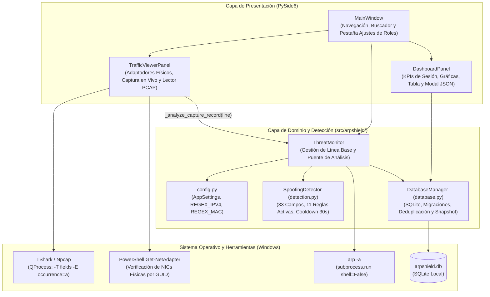
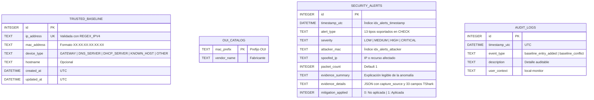
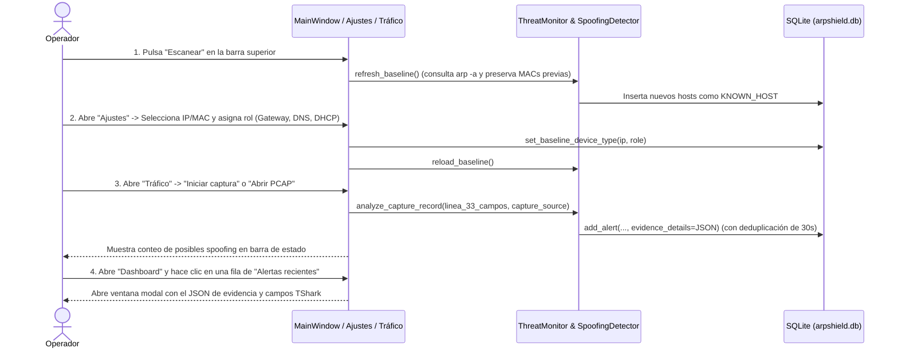

# ARPShield — Documentación Integral del Proyecto (SRS, Arquitectura, Evolución, CVE, Manual de Uso y Plan QA)

**Proyecto:** ARPShield — Monitor Local y Sistema de Detección de Suplantaciones (IDS/IPS) para Redes LAN  
**Versión del Documento:** 2.0.0 (Actualizada con Motor de Detección Multiprotocolo, Evidencia Forense y Generador PCAP)  
**Fecha de Consolidación:** 10 de noviembre de 2026  
**Equipo de Desarrollo (Capa 8):**
* **Andres Ferney Garcia Ramirez** (C.C. 1005564075) — *Líder Técnico & Desarrollador Principal*
* **Juan David Rico Aldana** (C.C. 1096801885) — *Responsable de Seguridad, Calidad & Documentador*

**Marcos Normativos y Estándares Aplicados:**
* **Ingeniería de Requisitos:** IEEE Std 830 / ISO/IEC/IEEE 29148
* **Seguridad en Aplicaciones:** OWASP Application Security Verification Standard (ASVS v4.0.3)
* **Desarrollo Seguro:** NIST Secure Software Development Framework (SSDF — SP 800-218)
* **Seguridad de Redes:** ISO/IEC 27033-1 (Cláusula 9.3) e ISO/IEC 27033-3 (Cláusula 7.2)
* **Modelado de Amenazas y Vulnerabilidades:** Microsoft STRIDE, NIST NVD (CVE / CVSS v3.1 & v4.0 / CWE) y CISA KEV

---

## Tabla de Contenidos

1. [Evolución del Proyecto (Comparativa Versión Inicial vs. Versión Actual)](#1-evolución-del-proyecto-comparativa-versión-inicial-vs-versión-actual)
2. [Especificación de Requisitos de Software (SRS)](#2-especificación-de-requisitos-de-software-srs)
   * [2.1 Propósito y Alcance](#21-propósito-y-alcance)
   * [2.2 Exclusiones Explícitas y Cautelas Operativas](#22-exclusiones-explícitas-y-cautelas-operativas)
   * [2.3 Perfiles de Usuario e Interesados](#23-perfiles-de-usuario-e-interesados)
   * [2.4 Requisitos Funcionales (RF)](#24-requisitos-funcionales-rf)
   * [2.5 Requisitos No Funcionales (RNF)](#25-requisitos-no-funcionales-rnf)
   * [2.6 Requisitos de Seguridad y Cumplimiento Normativo (RS)](#26-requisitos-de-seguridad-y-cumplimiento-normativo-rs)
3. [Arquitectura Técnica, Motor de Detección, Base de Datos y STRIDE](#3-arquitectura-técnica-motor-de-detección-base-de-datos-y-stride)
   * [3.1 Arquitectura de Componentes y Flujo de Datos](#31-arquitectura-de-componentes-y-flujo-de-datos)
   * [3.2 Motor de Correlación Multiprotocolo (`SpoofingDetector`)](#32-motor-de-correlación-multiprotocolo-spoofingdetector)
   * [3.3 Modelo Relacional de Base de Datos, Migraciones y Diccionario](#33-modelo-relacional-de-base-de-datos-migraciones-y-diccionario)
   * [3.4 Matriz de Amenazas STRIDE y Reglas de Validación](#34-matriz-de-amenazas-stride-y-reglas-de-validación)
4. [Análisis de Vulnerabilidades CVE (NIST NVD & CISA KEV)](#4-análisis-de-vulnerabilidades-cve-nist-nvd--cisa-kev)
   * [4.1 Alcance Metodológico de la Consulta NVD](#41-alcance-metodológico-de-la-consulta-nvd)
   * [4.2 CVEs de Protocolo y Ataques en Red Local](#42-cves-de-protocolo-y-ataques-en-red-local)
   * [4.3 CVEs Asociados al Stack Tecnológico e Infraestructura](#43-cves-asociados-al-stack-tecnológico-e-infraestructura)
   * [4.4 Mitigación Aportada por ARPShield y Límites Operativos](#44-mitigación-aportada-por-arpshield-y-límites-operativos)
5. [Matriz de Trazabilidad Integral (RTM)](#5-matriz-de-trazabilidad-integral-rtm)
6. [Manual de Instalación, Usuario y Operación](#6-manual-de-instalación-usuario-y-operación)
   * [6.1 Requisitos del Sistema e Instalación Paso a Paso](#61-requisitos-del-sistema-e-instalación-paso-a-paso)
   * [6.2 Recorrido por la Interfaz Gráfica](#62-recorrido-por-la-interfaz-gráfica)
   * [6.3 Flujo Operativo Paso a Paso (Escaneo, Clasificación, Captura y PCAP)](#63-flujo-operativo-paso-a-paso-escaneo-clasificación-captura-y-pcap)
   * [6.4 Solución de Problemas Frecuentes (Troubleshooting)](#64-solución-de-problemas-frecuentes-troubleshooting)
7. [Plan de Pruebas de QA, Seguridad y Escenarios PCAP](#7-plan-de-pruebas-de-qa-seguridad-y-escenarios-pcap)
   * [7.1 Estrategia y Niveles de Prueba](#71-estrategia-y-niveles-de-prueba)
   * [7.2 Ejecución de Pruebas Unitarias y Generador de Capturas Scapy](#72-ejecución-de-pruebas-unitarias-y-generador-de-capturas-scapy)
   * [7.3 Catálogo Completo de Casos de Prueba (`TC-01` a `TC-24`)](#73-catálogo-completo-de-casos-de-prueba-tc-01-a-tc-24)
   * [7.4 Protocolo de Validación con los Archivos `captures/*.pcap`](#74-protocolo-de-validación-con-los-archivos-capturespcap)
8. [Estado Actual de Implementación y Pendientes Técnicos](#8-estado-actual-de-implementación-y-pendientes-técnicos)

---

## 1. Evolución del Proyecto (Comparativa Versión Inicial vs. Versión Actual)

A continuación se documenta la evolución funcional y arquitectónica entre la versión base del prototipo y la versión actual tras la incorporación del motor de correlación multiprotocolo, las migraciones automáticas en SQLite, la gestión de roles confiables y el generador de escenarios PCAP:

| Dimensión Técnica | Estado Inicial (Prototipo Base) | Estado Actual (Versión Mejorada) |
|---|---|---|
| **Módulo de Detección** | Solo existía `ThreatMonitor.check_for_anomalies()` comparando `arp -a`. No existía `detection.py`. | Nuevo módulo [`src/arpshield/detection.py`](../src/arpshield/detection.py) con la clase [`SpoofingDetector`](../src/arpshield/detection.py) que correlaciona paquetes en vivo y archivos PCAP. |
| **Campos Extraídos de TShark** | 17 campos básicos (Ethernet, ARP, DNS A, IPv4/IPv6) con `-E occurrence=f`. | **33 campos (`CAPTURE_FIELDS`)** con `-E occurrence=a`, añadiendo DHCP (`dhcp.*`), DNS (`dns.id`, `dns.aaaa`), NBNS (`nbns.*`), ICMPv6/NDP (`icmpv6.*`), DHCPv6 (`dhcpv6.*`) y puertos UDP (`udp.srcport`, `udp.dstport`). |
| **Categorías de Alerta (`ALERT_TYPES`)** | 4 tipos en esquema (`GATEWAY_SPOOFING`, `MULTIPLE_IPS_PER_MAC`, `ARP_BURST_UNSOLICITED`, `DNS_SPOOFING`), pero el código solo disparaba `GATEWAY_SPOOFING`. | **13 tipos de alerta** en esquema y **11 reglas activas**: `GATEWAY_SPOOFING`, `ARP_SPOOFING`, `IP_SPOOFING`, `MAC_SPOOFING`, `DNS_SPOOFING`, `DHCP_SPOOFING`, `DHCPV6_SPOOFING`, `LLMNR_SPOOFING`, `NBNS_SPOOFING`, `MDNS_SPOOFING` y `NDP_SPOOFING` (más 2 reservadas). |
| **Roles en Línea Base (`DEVICE_TYPES`)** | 4 roles (`GATEWAY`, `DNS_SERVER`, `KNOWN_HOST`, `OTHER`) sin interfaz para editarlos; `refresh_baseline()` sobrescribía las MACs existentes. | **5 roles** (añade `DHCP_SERVER`), selector en la pestaña **Ajustes** para clasificar dispositivos ([`set_baseline_device_type()`](../src/arpshield/database.py)), y `refresh_baseline()` **preserva las MACs confiables previas** registrando `baseline_conflict` en `audit_logs`. |
| **Base de Datos y Evidencia (`database.py`)** | Sin columna de detalle de paquete, sin migraciones automáticas, sin deduplicación y el Dashboard mostraba alertas históricas acumuladas. | Nueva columna **`evidence_details` (JSON)** en `security_alerts`, **migraciones automáticas en caliente** (`_migrate_*`), **deduplicación de 30 segundos** y métricas de Dashboard aisladas por sesión (`_session_alert_start_id`). |
| **Visor de Tráfico (`traffic_viewer.py`)** | Desconectado de `ThreatMonitor`; listaba cualquier interfaz de TShark por índice numérico (`-i 1`) y filtro `arp or dns`. | Conectado a `monitor.analyze_capture_record()` tanto en vivo como al abrir PCAP; correlaciona interfaces Npcap con **adaptadores físicos de Windows** (`Get-NetAdapter -Physical`), excluye interfaces `extcap` (`sshdump`, `ciscodump`), captura por nombre estable `\Device\NPF_{GUID}` e incorpora un *watchdog* de 5 s. |
| **Dashboard (`dashboard.py`)** | Tabla estática de alertas sin vista de detalle. | Al hacer clic en una alerta abre un **diálogo modal (`_show_alert_details`)** con el JSON completo de metadatos y campos del paquete capturado (`alert_details_text`). |
| **Uso de Scapy y Pruebas QA** | `scapy` no se usaba en el repositorio; existían solo 2 archivos de pruebas (`test_database.py` y `test_traffic_viewer.py`). | Nuevo generador con `Scapy` ([`prueba/generator.py`](../prueba/generator.py)) que produce 5 capturas en `captures/*.pcap`, y suite ampliada a **4 archivos de pruebas unitarias** (añade [`test_detection.py`](../tests/test_detection.py) y [`test_dashboard.py`](../tests/test_dashboard.py)). |

---

## 2. Especificación de Requisitos de Software (SRS)

### 2.1 Propósito y Alcance
**ARPShield** es un monitor local de seguridad de red y sistema de detección de intrusiones (IDS/IPS) de escritorio para **Windows 10 y Windows 11**. Está orientado a detectar señales tempranas de suplantación en redes LAN pequeñas (universidades, laboratorios y PyMEs) mediante:
1. **Monitoreo de la tabla ARP del sistema operativo (`arp -a`)** frente a una línea base confiable.
2. **Inspección pasiva multiprotocolo en tiempo real y sobre archivos `.pcap`/`.pcapng`** empleando `TShark`/`Npcap` y el motor `SpoofingDetector` para analizar **ARP, IPv4/IPv6, DNS, DHCP/DHCPv6, LLMNR, NBNS, mDNS e ICMPv6/NDP**.
3. **Persistencia forense estructurada en SQLite** con detalles de cabecera en formato JSON, deduplicación temporal y bitácora de auditoría.
4. **Panel gráfico interactivo en `PySide6`** con clasificación de roles de confianza (*Gateway*, *DNS*, *DHCP*) e inspección detallada de evidencia por alerta.

### 2.2 Exclusiones Explícitas y Cautelas Operativas
* **Privacidad de Capa de Aplicación (`OWASP ASVS V7.4.1`):** No descifra tráfico TLS/HTTPS ni almacena el *payload* de aplicación; únicamente registra metadatos y los 33 campos de cabecera extraídos por TShark.
* **Visibilidad en Redes Conmutadas y Wi-Fi:** En un switch Ethernet estándar, el adaptador de un equipo solo recibe tráfico broadcast, multicast y unicast dirigido a sí mismo. Para observar intercambios unicast entre terceros se requiere un puerto espejo (*Port Mirroring / SPAN*) o un *Network TAP*.
* **Interpretación de Alertas de Severidad `MEDIUM`:** Las alertas basadas en listas de confianza (*allowlists*) o respuestas concurrentes constituyen **señales de revisión**, no una confirmación absoluta de intrusión (cambios legítimos de tarjeta NIC, *multihoming*, balanceo *round-robin*, DNS de horizonte dividido o múltiples servidores DHCP/routers IPv6 autorizados pueden generar discrepancias legítimas).
* **Reglas Reservadas:** Las categorías `MULTIPLE_IPS_PER_MAC` y `ARP_BURST_UNSOLICITED` están declaradas en el esquema SQLite para compatibilidad documental, pero no tienen reglas de disparo activas en la versión actual.

### 2.3 Perfiles de Usuario e Interesados
| Perfil | Descripción Técnica | Necesidades Principales en ARPShield |
|---|---|---|
| **Administrador de Red / Laboratorio** | Responsable de supervisar una subred LAN compartida. | Escanear la red, clasificar los roles autorizados (`GATEWAY`, `DNS_SERVER`, `DHCP_SERVER`), capturar tráfico en vivo y revisar la evidencia JSON de cada alerta. |
| **Analista Forense / Evaluador QA** | Encargado de investigar incidentes a partir de trazas de red. | Cargar archivos `.pcap` / `.pcapng` (como los de la carpeta `captures/`), verificar qué reglas de `SpoofingDetector` se activan y auditar `security_alerts` y `audit_logs`. |
| **Usuario de Endpoint Windows** | Usuario conectado a una red local compartida. | Detectar si la dirección MAC de su puerta de enlace cambió inesperadamente. |

### 2.4 Requisitos Funcionales (RF)

| ID | Nombre del Requisito | Descripción Detallada | Estado |
|---|---|---|---|
| **RF-01** | **Descubrimiento ARP y Preservación de Línea Base** | Consultar `arp -a`, validar IPv4 y MAC con Regex y agregar nuevos dispositivos a `trusted_baseline` sin sobrescribir las direcciones MAC ya registradas; si se observa una MAC distinta durante el escaneo, registrar `baseline_conflict` en `audit_logs`. | **Implementado** |
| **RF-02** | **Clasificación Manual de Roles de Confianza** | Permitir al usuario desde la pestaña **Ajustes** asignar a cualquier IP de la línea base su rol verificado: `GATEWAY`, `DNS_SERVER`, `DHCP_SERVER`, `KNOWN_HOST` u `OTHER`. | **Implementado** |
| **RF-03** | **Detección de Adaptadores Físicos y Captura en Vivo** | Enumerar interfaces con `tshark -D`, correlacionarlas por GUID con `Get-NetAdapter -Physical` en Windows, descartar interfaces virtuales/`extcap`, verificar que el adaptador esté en estado `Up` y capturar 33 campos de protocolo mediante `QProcess`. | **Implementado** |
| **RF-04** | **Correlación Multiprotocolo (`SpoofingDetector`)** | Analizar cada registro de captura para detectar anomalías de tipo `GATEWAY_SPOOFING`, `ARP_SPOOFING`, `IP_SPOOFING`, `MAC_SPOOFING`, `DNS_SPOOFING`, `DHCP_SPOOFING`, `DHCPV6_SPOOFING`, `LLMNR_SPOOFING`, `NBNS_SPOOFING`, `MDNS_SPOOFING` y `NDP_SPOOFING`. | **Implementado** |
| **RF-05** | **Análisis Forense de Archivos PCAP / PCAPNG** | Permitir abrir capturas `.pcap` y `.pcapng` desde la pestaña **Tráfico**, mostrar sus paquetes en la tabla y pasar cada registro por `ThreatMonitor.analyze_capture_record(capture_source="Archivo PCAP/PCAPNG")`. | **Implementado** |
| **RF-06** | **Persistencia con Evidencia JSON, Migración y Deduplicación** | Almacenar alertas en `security_alerts` incluyendo `evidence_details` (JSON con los 33 campos de TShark y fuente de captura), aplicar deduplicación en ventana de 30 segundos y migrar automáticamente bases de datos de versiones previas. | **Implementado** |
| **RF-07** | **Dashboard por Sesión y Visor de Detalle de Alerta** | Mostrar en el Dashboard las métricas y gráficas de las alertas generadas en la sesión activa (`id > _session_alert_start_id`) y abrir un diálogo modal con el JSON detallado al hacer clic sobre cualquier fila de la tabla. | **Implementado** |
| **RF-08** | **Mitigación Local con `netsh` y Reversión** | Fijar entradas ARP estáticas en Windows mediante `netsh interface ipv4 add neighbors` previa elevación administrativa y revertirlas al cerrar sesión. | **Planificado / Documentado** |

### 2.5 Requisitos No Funcionales (RNF)

| ID | Categoría | Especificación y Métrica de Aceptación |
|---|---|---|
| **RNF-01** | **Rendimiento y Fluidez de Interfaz** | Actualización de la tabla de paquetes por lotes, columnas con dimensionamiento `Interactive` fijo (evitando recálculos $O(N^2)$ de `ResizeToContents`) y refresco del Dashboard cada 15 s únicamente cuando la pestaña está visible. |
| **RNF-02** | **Control de Memoria y Deduplicación** | Límite de historial visual de paquetes (`MAX_PACKET_ROWS`), límite de 100 alertas recientes en el Dashboard (`RECENT_ALERT_LIMIT = 100`), diccionario LRU acotado a `MAX_TRACKED_TRANSACTIONS = 2048` con `STATE_TTL_SECONDS = 300` y cooldown de alertas de `30 s`. |
| **RNF-03** | **Diagnóstico Proactivo de Captura (*Watchdog*)** | Si transcurren 5 segundos de captura en vivo sin recibir paquetes (`_capture_watchdog`), informar en la barra de estado las posibles causas (filtro, interfaz o conmutación de switch sin puerto espejo/TAP). |
| **RNF-04** | **Retrocompatibilidad de Datos** | Las bases de datos SQLite creadas con esquemas anteriores deben actualizar sus restricciones `CHECK` y nuevas columnas automáticamente en `DatabaseManager.initialize()` mediante transacciones seguras (`BEGIN` / `COMMIT` / `ROLLBACK`). |

### 2.6 Requisitos de Seguridad y Cumplimiento Normativo (RS)

| ID | Norma / Cláusula | Requisito de Seguridad | Implementación en ARPShield |
|---|---|---|---|
| **RS-01** | **OWASP ASVS V5.1.1 & V5.2.2** | Invocación segura de subprocesos sin intérprete de comandos. | Llamadas a `arp -a`, `tshark`, `powershell.exe (Get-NetAdapter)` y `netsh` con `shell=False` o `QProcess`, y validación previa con `REGEX_IPV4` y `REGEX_MAC`. |
| **RS-02** | **OWASP ASVS V5.1.4** | Mitigación de agotamiento de recursos (DoS) en captura y correlación. | Estructuras acotadas en memoria (`OrderedDict` con tope de 2.048 transacciones, expiración de 300 s, deduplicación de 30 s en detector y en SQLite, y límite de filas en UI). |
| **RS-03** | **OWASP ASVS V7.1.1 & V7.4.1** | Manejo controlado de excepciones y no persistencia de payloads. | Captura de errores `ImportError`, `OSError`, `sqlite3.Error` y `TimeoutExpired` presentando mensajes claros al usuario; extracción exclusiva de cabeceras de red. |
| **RS-04** | **OWASP ASVS V8.3.1** | Integridad de la línea base y protección contra contaminación. | No sobrescritura de MACs confiables en `refresh_baseline()`, consultas SQL parametrizadas (`?`) y diseño de verificación `SHA-256`. |
| **RS-05** | **NIST SSDF PW.1.1** | Principio de Mínimo Privilegio. | Ejecución en contexto de usuario estándar para monitoreo y análisis de archivos PCAP. |
| **RS-06** | **ISO/IEC 27033-1 Cl. 9.3 & 27033-3 Cl. 7.2** | Trazabilidad forense y detección anti-spoofing. | Almacenamiento de evidencia completa del paquete (`evidence_details` JSON) y bitácora `audit_logs` con marcas de tiempo UTC. |

---

## 3. Arquitectura Técnica, Motor de Detección, Base de Datos y STRIDE

### 3.1 Arquitectura de Componentes y Flujo de Datos



### 3.2 Motor de Correlación Multiprotocolo (`SpoofingDetector`)

El módulo [`src/arpshield/detection.py`](../src/arpshield/detection.py) define la tupla `CAPTURE_FIELDS` con **33 campos de TShark** y evalúa cada paquete contra `trusted_baseline` y contra el historial reciente de transacciones (`OrderedDict` con TTL de 300 s):

| Tipo de Alerta | Severidad | Condición Técnica de Disparo en `SpoofingDetector` / `ThreatMonitor` |
|---|---|---|
| **`GATEWAY_SPOOFING`** | `HIGH` | Un anuncio ARP (`arp.opcode`), una entrada en `arp -a` o un paquete IP usando la IP de un dispositivo clasificado como `GATEWAY` presenta una dirección MAC distinta a la registrada en `trusted_baseline`. |
| **`ARP_SPOOFING`** | `MEDIUM` / `HIGH` | 1) Anuncio ARP para un host de la línea base (no `GATEWAY`) con MAC distinta (`MEDIUM`).<br>2) La MAC de origen Ethernet (`eth.src`) difiere de la MAC anunciada dentro del encabezado ARP (`arp.src.hw_mac`) (`HIGH`). |
| **`IP_SPOOFING`** | `MEDIUM` | Un paquete no-ARP tiene una IP de origen (`ip.src` / `ipv6.src`) registrada en la línea base, pero proviene de una MAC Ethernet (`eth.src`) diferente a la esperada. |
| **`MAC_SPOOFING`** | `MEDIUM` | La MAC de origen (`eth.src`) pertenece a un equipo de confianza en `trusted_baseline`, pero está emitiendo tráfico con una dirección IP de origen que no figura entre sus IPs asociadas. |
| **`DNS_SPOOFING`** | `MEDIUM` | 1) Respuesta DNS (`dns.flags.response == 1`, excluyendo mDNS puerto `5353` y LLMNR puerto `5355`) proveniente de una IP que no está en el conjunto de `DNS_SERVER` confiables.<br>2) Dos respuestas para el mismo `(dns.id, dns.qry.name, ip_dst)` desde distintas MACs devuelven conjuntos de registros `A`/`AAAA` diferentes. |
| **`DHCP_SPOOFING`** | `MEDIUM` | 1) Oferta/ACK DHCP (`dhcp.type` en `{"2", "5"}`) desde un servidor que no figura en `DHCP_SERVER`.<br>2) Dos servidores DHCP distintos responden al mismo ID de transacción BOOTP (`dhcp.id`). |
| **`DHCPV6_SPOOFING`** | `MEDIUM` | 1) Mensaje DHCPv6 Advertise/Reply (`dhcpv6.msgtype` en `{"2", "7"}`) desde una MAC que no pertenece a un `DHCP_SERVER` confiable.<br>2) Respuestas desde distintas MACs para la misma transacción `dhcpv6.xid`. |
| **`NBNS_SPOOFING`** | `MEDIUM` | Respuestas NetBIOS Name Service (`nbns.flags.response == 1`) contradictorias (`nbns.addr` distinto) para el mismo `(nbns.id, nbns.name)`. |
| **`LLMNR_SPOOFING`** | `MEDIUM` | Respuestas LLMNR (protocolo `llmnr` o puerto UDP `5355`) contradictorias para el mismo `(dns.id, dns.qry.name)`. |
| **`MDNS_SPOOFING`** | `MEDIUM` | Respuestas Multicast DNS (protocolo `mdns` o puerto UDP `5353`) contradictorias para el mismo `(dns.id, dns.qry.name)`. |
| **`NDP_SPOOFING`** | `MEDIUM` | 1) *Router Advertisement* ICMPv6 (`icmpv6.type == 134`) emitido desde una MAC no clasificada como `GATEWAY` (o no registrada en `trusted_baseline`).<br>2) *Neighbor Advertisement* (`icmpv6.type == 136`) anunciando una MAC distinta para el mismo objetivo IPv6 (`icmpv6.nd.na.target_address`). |
| **`MULTIPLE_IPS_PER_MAC`** / **`ARP_BURST_UNSOLICITED`** | Reservadas | Incluidas en el `CHECK` de `security_alerts` por trazabilidad documental; sin regla de disparo activa en la versión actual. |

### 3.3 Modelo Relacional de Base de Datos, Migraciones y Diccionario

El módulo [`src/arpshield/database.py`](../src/arpshield/database.py) administra cuatro tablas y ejecuta tres rutinas de migración automática (`_migrate_device_types`, `_migrate_alert_types`, `_migrate_alert_details`) al iniciar:



### 3.4 Matriz de Amenazas STRIDE y Reglas de Validación

| # | Amenaza STRIDE | Activo Protegido | Control Implementado en el Código |
|---|---|---|---|
| **1** | **Denial of Service (DoS)** | `SpoofingDetector`, `DatabaseManager` y `TrafficViewerPanel`. | Límite de `MAX_TRACKED_TRANSACTIONS = 2048`, expiración `STATE_TTL_SECONDS = 300`, deduplicación de alertas de `30 s` en memoria y en SQLite (`WHERE NOT EXISTS ... datetime('now', '-30 seconds')`), y actualización de tabla por lotes. |
| **2** | **Elevation of Privilege (EoP)** | Subprocesos `tshark`, `arp` y `powershell.exe`. | Uso estricto de listas de argumentos con `shell=False` / `QProcess`, exclusión de interfaces remotas `UNSUPPORTED_EXTCAP_INTERFACES` y validación con `REGEX_IPV4` / `REGEX_MAC`. |
| **3** | **Tampering (Alteración)** | Tabla `trusted_baseline` en `arpshield.db`. | `ThreatMonitor.refresh_baseline()` impide que un escaneo posterior sobrescriba la MAC de un dispositivo ya registrado en la línea base, alertando en `audit_logs` mediante `baseline_conflict`. |
| **4** | **Information Disclosure** | Columna `evidence_details` y diálogos de error. | `evidence_details` almacena únicamente los 33 campos de cabecera (`CAPTURE_FIELDS`) sin ningún payload de aplicación (`OWASP ASVS V7.4.1`). Los fallos de carga o base de datos se muestran con diálogos controlados sin *stack traces*. |

---

## 4. Análisis de Vulnerabilidades CVE (NIST NVD & CISA KEV)

### 4.1 Alcance Metodológico de la Consulta NVD
Los registros verificados en la **National Vulnerability Database (NVD)** del NIST y el catálogo **CISA KEV** respaldan tanto las amenazas de protocolo que ARPShield detecta como los controles defensivos aplicados a las herramientas del stack (`Scapy`, `TShark`, `Npcap`).

### 4.2 CVEs de Protocolo y Ataques en Red Local

| Identificador CVE | Estado CISA KEV | Publicación NVD | Fuente / CNA | Severidad CVSS y CWE | Descripción en NVD y Cobertura Actual en ARPShield |
|---|---|---|---|---|---|
| **[CVE-1999-0667](https://nvd.nist.gov/vuln/detail/CVE-1999-0667)** | No listado | `1997-09-18` | `cve@mitre.org` | **CVSS v2.0:** `10.0 HIGH`<br>`NVD-CWE-Other` | Permite falsificar respuestas ARP para envenenar la caché ARP y causar MiTM o DoS. Cubierto directamente por las reglas `GATEWAY_SPOOFING`, `ARP_SPOOFING`, `IP_SPOOFING` y `MAC_SPOOFING` en [`detection.py`](../src/arpshield/detection.py) y [`monitor.py`](../src/arpshield/monitor.py). |
| **[CVE-2018-17195](https://nvd.nist.gov/vuln/detail/CVE-2018-17195)** | No listado | `2018-12-19` | `security@apache.org` | **CVSS v3.0:** `7.5 HIGH`<br>`CWE-319` / `CWE-863` | En Apache NiFi `1.0.0`–`1.7.1`, el posicionamiento MiTM mediante *ARP spoofing* en la subred permitía explotar CSRF. ARPShield actúa como sensor temprano en Capa 2/3 ante este tipo de posicionamiento en LAN. |
| **[CVE-2019-11189](https://nvd.nist.gov/vuln/detail/CVE-2019-11189)** | No listado | `2020-02-20` | `cve@mitre.org` | **CVSS v3.1:** `7.5 HIGH`<br>`CWE-290` | Respuestas ARP gratuitas (*Gratuitous ARP*, `opcode 2`) manipuladas en ONOS `<= 2.0.0` eludían controles de acceso. `SpoofingDetector` inspecciona todos los anuncios ARP contrastando `arp.src.proto_ipv4`, `arp.src.hw_mac` y `eth.src`. |
| **[CVE-2021-32575](https://nvd.nist.gov/vuln/detail/CVE-2021-32575)** | No listado | `2021-06-17` | `cve@mitre.org` | **CVSS v3.1:** `6.5 MEDIUM`<br>`CWE-1100` | *ARP spoofing* entre tareas en modo `bridge` en HashiCorp Nomad `<= 1.0.4`. Cubierto cuando el tráfico alcanza la interfaz monitoreada o al analizar la captura `.pcap` del segmento. |
| **[CVE-2025-52890](https://nvd.nist.gov/vuln/detail/CVE-2025-52890)** | No listado | `2025-06-25` | `github.com` | **CVSS v3.1:** `8.1 HIGH`<br>`CWE-863` | Evasión parcial de filtrado MAC/IPv4 en puentes de Incus `6.12`–`6.13` permitiendo suplantación ARP/IP. Detectable mediante las reglas `ARP_SPOOFING`, `IP_SPOOFING` y `NDP_SPOOFING` de ARPShield. |
| **[CVE-2008-1447](https://nvd.nist.gov/vuln/detail/CVE-2008-1447)** | No listado | `2008-07-08` | `cve@mitre.org` | **CVSS v3.1:** `6.8 MEDIUM`<br>`CWE-330` | Falsificación de respuestas DNS (*cache poisoning*) por colisión de ID de transacción. Cubierto en [`SpoofingDetector`](../src/arpshield/detection.py) mediante verificación de servidores `DNS_SERVER` confiables y detección de respuestas contradictorias para la misma tupla `(dns.id, dns.qry.name, ip_dst)`. |

### 4.3 CVEs Asociados al Stack Tecnológico e Infraestructura

| Identificador CVE | Publicación NVD | Componente | Severidad CVSS y CWE | Amenaza STRIDE | Control Aplicado en ARPShield |
|---|---|---|---|---|---|
| **[CVE-2019-1010142](https://nvd.nist.gov/vuln/detail/CVE-2019-1010142)** | `2019-07-19` | `Scapy` | **CVSS v3.1:** `7.5 HIGH` · `CWE-835` | **STRIDE #1: DoS** | Uso de `scapy >= 2.8.0` únicamente para generación controlada de escenarios de laboratorio (`prueba/generator.py`), delegando la disección de red en vivo a `TShark` con estructuras de memoria acotadas (`ASVS V5.1.4`). |
| **[CVE-2026-3959](https://nvd.nist.gov/vuln/detail/CVE-2026-3959)** | `2026-03-11` | `TShark` (Conector CLI) | **CVSS v3.1:** `5.3 MEDIUM` · `CWE-78` | **STRIDE #2: EoP** | Ejecución de `tshark` exclusivamente mediante `QProcess.start(executable, arguments)` sin invocación de shell y excluyendo interfaces `extcap` remotas (`ASVS V5.1.1 & V5.2.2`). |
| **[CVE-2026-33921](https://nvd.nist.gov/vuln/detail/CVE-2026-33921)** | `2026-08-11` | `Npcap` | **CVSS v3.1:** `5.2 MEDIUM` · `CWE-1188` | **STRIDE #4: Info Disclosure** | Principio de mínimo privilegio (`NIST SSDF PW.1.1`), selección exclusiva de adaptadores físicos locales y no almacenamiento de payloads (`ASVS V7.4.1`). |

### 4.4 Mitigación Aportada por ARPShield y Límites Operativos
* **Cobertura ampliada en Capa 2 y Capa 3:** Con la incorporación de `SpoofingDetector`, el proyecto ya no se limita a ARP y DNS básico, sino que cubre suplantaciones **DHCP/DHCPv6, IPv6 NDP (Router/Neighbor Advertisements) y protocolos de nombres locales (LLMNR, NBNS, mDNS)**.
* **Límite físico en switches:** Como advierte el propio *watchdog* de `TrafficViewerPanel`, un host en una red conmutada solo puede analizar las tramas que llegan a su tarjeta de red; para monitorear toda la subred se debe emplear un puerto espejo (SPAN) o un TAP.

---

## 5. Matriz de Trazabilidad Integral (RTM)

| Requisito SRS | Componente Oficial | CVE / STRIDE Asociado | Control Normativo | Módulo en Código (`src/arpshield/`) | Pruebas Automatizadas (`tests/`) | Estado Actual |
|---|---|---|---|---|---|---|
| **RF-01** (Descubrimiento y Preservación de Línea Base) | 01 Captura / 03 Base de Datos | `CVE-1999-0667` · STRIDE #3 | `OWASP ASVS V5.1 & V8.3.1` | [`monitor.py`](../src/arpshield/monitor.py) (`refresh_baseline`, `discover_local_network`) | `test_database.py` (`TC-04`, `TC-08`, `TC-09`) | **Implementado** |
| **RF-02** (Clasificación de Roles Confiables) | 03 Base de Datos / 04 GUI | `CVE-1999-0667`, `CVE-2008-1447` | `ISO/IEC 27033-3 Cl. 7.2` | [`database.py`](../src/arpshield/database.py) (`set_baseline_device_type`) · [`ui/main_window.py`](../src/arpshield/ui/main_window.py) | `test_database.py` (`TC-03`) | **Implementado** |
| **RF-03** (Captura en Adaptadores Físicos) | 01 Captura de Tráfico | `CVE-2026-3959`, `CVE-2026-33921` · STRIDE #1, #2, #4 | `OWASP ASVS V5.1.1, V5.1.4, V7.4.1` | [`ui/traffic_viewer.py`](../src/arpshield/ui/traffic_viewer.py) (`windows_physical_adapters`, `start_capture`) | `test_traffic_viewer.py` (`TC-19` a `TC-24`) | **Implementado** |
| **RF-04** (Detector Multiprotocolo) | 02 Analizador de Amenazas | `CVE-1999-0667`, `CVE-2008-1447`, `CVE-2019-11189`, `CVE-2025-52890` | `ISO/IEC 27033-3 Cl. 7.2` | [`detection.py`](../src/arpshield/detection.py) (`SpoofingDetector.analyze`) | `test_detection.py` (`TC-10` a `TC-17`) | **Implementado (11 reglas activas)** |
| **RF-05** (Análisis Forense PCAP) | 05 Análisis de Archivos PCAP | `CVE-2021-32575`, `CVE-2025-52890` | `OWASP ASVS V5.1.1` | [`ui/traffic_viewer.py`](../src/arpshield/ui/traffic_viewer.py) (`load_capture_file`) · [`prueba/generator.py`](../prueba/generator.py) | `test_detection.py` + `captures/*.pcap` | **Implementado** |
| **RF-06** (SQLite, Evidencia JSON y Deduplicación) | 03 Base de Datos | STRIDE #1 & #3 | `ISO/IEC 27033-1 Cl. 9.3` | [`database.py`](../src/arpshield/database.py) (`add_alert`, `_migrate_*`) | `test_database.py` (`TC-01` a `TC-07`) | **Implementado** |
| **RF-07** (Dashboard por Sesión y Detalle Modal) | 04 Panel de Monitoreo (GUI) | Observabilidad Forense | `OWASP ASVS V7.1.1 & V7.4.1` | [`ui/dashboard.py`](../src/arpshield/ui/dashboard.py) (`alert_details_text`, `_show_alert_details`) | `test_dashboard.py` (`TC-18`) · `test_database.py` (`TC-06`, `TC-07`) | **Implementado** |
| **RF-08** (Mitigación `netsh`) | 06 Protección de Tabla ARP | `CVE-1999-0667` · STRIDE #2 | `OWASP ASVS V5.2.2` · `NIST PW.1.1` | [`ui/main_window.py`](../src/arpshield/ui/main_window.py) (`apply_mitigation`) | Documentado en guía de desarrollo | **Planificado** |

---

## 6. Manual de Instalación, Usuario y Operación

### 6.1 Requisitos del Sistema e Instalación Paso a Paso

#### A. Requisitos del Sistema
* **Sistema Operativo:** Windows 10 o Windows 11 (x64).
* **Memoria RAM:** 4 GB mínimo (8 GB recomendados).
* **Wireshark / TShark y Npcap:** Instala Wireshark asegurándote de incluir **TShark** y el controlador **Npcap**.

#### B. Instalación y Ejecución
```powershell
# 1. Crear y activar el entorno virtual del proyecto
python -m venv .venv
.\.venv\Scripts\Activate.ps1

# 2. Instalar dependencias (PySide6 y Scapy)
python -m pip install -r requirements.txt

# 3. Ejecutar ARPShield
python main.py
```

---

### 6.2 Recorrido por la Interfaz Gráfica

1. **Barra Superior:**
   * **`Buscar en alertas...`:** Filtra en tiempo real las alertas mostradas en el Dashboard.
   * **Botón `Escanear`:** Ejecuta `arp -a` y agrega nuevos dispositivos a la línea base (sin sobrescribir las MACs confiables ya existentes).
   * **Botón `Verificar`:** Comprueba si alguna entrada actual de `arp -a` contradice la línea base guardada.
2. **Pestaña `◈ Dashboard`:**
   * **4 Tarjetas KPI:** *Dispositivos detectados*, *Alertas de esta sesión* (inicia en `0` cada vez que abres la app), *Riesgo alto / crítico* y *Entradas de confianza*.
   * **Gráficas:** *Tendencia de alertas* (últimos 12 días) y *Clasificación de incidentes* (anillo porcentual con los 13 tipos de spoofing).
   * **Tabla `Alertas recientes` (Interactiva):** Haz **clic sobre cualquier fila** para abrir la ventana emergente **Detalle de alerta**, que muestra el JSON completo con el resumen y los 33 campos de paquete capturados por TShark.
3. **Pestaña `◎ Tráfico`:**
   * **Selector `Interfaz`:** Muestra únicamente los adaptadores físicos reales de Windows asociados a Npcap junto con su estado (ej. `1. Ethernet · Up · \Device\NPF_{...}`).
   * **Campo `Filtro`:** Viene preconfigurado con el filtro multiprotocolo:
     `arp or dns or dhcp or dhcpv6 or bootp or llmnr or nbns or mdns or icmpv6`
   * **Botones:** `Detectar interfaces`, `Iniciar captura`, `Detener` y `Abrir PCAP`.
4. **Pestaña `⚙ Ajustes`:**
   * Muestra la ruta detectada de `TShark` y la ubicación de `arpshield.db`.
   * **Sección `Clasificar dispositivos de confianza`:** Permite elegir cualquier dispositivo escaneado (`IP · MAC`), asignarle su rol autorizado (**Gateway**, **Servidor DNS**, **Servidor DHCP/DHCPv6**, **Equipo conocido** u **Otro**) y guardarlo con el botón **`Guardar rol confiable`**.

---

### 6.3 Flujo Operativo Paso a Paso (Escaneo, Clasificación, Captura y PCAP)



---

### 6.4 Solución de Problemas Frecuentes (*Troubleshooting*)

| Problema / Mensaje | Causa | Solución |
|---|---|---|
| ***"No se encontró un adaptador físico asociado a Npcap"*** | Las interfaces de TShark no corresponden a adaptadores físicos activos o Npcap no está ligado a la tarjeta Ethernet/Wi-Fi. | Verifica en Windows que el adaptador Wi-Fi o Ethernet esté habilitado, reinstala Npcap con soporte WinPcap/NDIS y pulsa `Detectar interfaces`. |
| ***"El adaptador seleccionado está Disconnected; conéctalo a la red antes de capturar"*** | Seleccionaste una tarjeta física (ej. Ethernet por cable) que no tiene cable conectado mientras usas Wi-Fi. | Selecciona en el desplegable el adaptador que aparezca con estado **`Up`**. |
| ***"Captura activa, pero no llegan paquetes que coincidan con el filtro..."*** | El *watchdog* de 5 segundos detectó 0 paquetes. En una LAN conmutada el switch no reenvía tráfico unicast de otros hosts. | Genera tráfico local (ej. `nslookup example.com` o `arp -a`), amplía el filtro o utiliza un puerto espejo (SPAN) / TAP de red. |
| **Conflictos de Git (`SyntaxError: invalid decimal literal`) al hacer `git pull`** | Se realizó un merge automático con conflictos sin resolver antes de hacer commit. | Resuelve los bloques `<<<<<<< HEAD ... >>>>>>>` en los archivos de `src/arpshield/ui/` antes de confirmar el commit. |

---

## 7. Plan de Pruebas de QA, Seguridad y Escenarios PCAP

### 7.1 Estrategia y Niveles de Prueba
El aseguramiento de calidad (QA) de ARPShield abarca **4 suites de pruebas unitarias automatizadas** (`tests/`) y **5 archivos de captura forense generados con Scapy** (`captures/`):
1. **[`tests/test_database.py`](../tests/test_database.py):** Creaciones de tablas, migraciones en caliente (`device_type`, `alert_type`, `evidence_details`), deduplicación de 30 s, inicio de sesión en 0 alertas, agregaciones del dashboard y preservación de MACs en `refresh_baseline()`.
2. **[`tests/test_detection.py`](../tests/test_detection.py):** Validación exhaustiva de las reglas de `SpoofingDetector` (Gateway/ARP, IP, MAC, DNS no confiable y respuestas en conflicto, orden de registros DNS, exclusión de mDNS como resolver DNS, DHCP y DHCPv6, NBNS/mDNS/LLMNR y anuncios IPv6 NDP).
3. **[`tests/test_traffic_viewer.py`](../tests/test_traffic_viewer.py):** Esquema de 33 campos (`CAPTURE_FIELDS`), parseo de interfaces Npcap, mapeo de adaptadores físicos por GUID, exclusión de interfaces remotas `extcap` y formateo de filas.
4. **[`tests/test_dashboard.py`](../tests/test_dashboard.py):** Renderizado JSON de metadatos y campos de paquete en `alert_details_text()`.

### 7.2 Ejecución de Pruebas Unitarias y Generador de Capturas Scapy

```powershell
# Ejecutar toda la suite de pruebas unitarias
python -m unittest discover -s tests -p "test_*.py" -v

# Regenerar los 5 archivos PCAP de prueba en la carpeta captures/ usando Scapy
python prueba/generator.py
```

### 7.3 Catálogo Completo de Casos de Prueba (`TC-01` a `TC-24`)

| ID | Suite | Método de Prueba | Qué Valida |
|---|---|---|---|
| **TC-01** | `test_database.py` | `test_initialize_creates_tables` | Creación de `trusted_baseline`, `oui_catalog`, `security_alerts` y `audit_logs`. |
| **TC-02** | `test_database.py` | `test_initialize_migrates_existing_alert_constraint` | Migración automática de bases de datos antiguas de 4 tipos de alerta a los 13 actuales y columna `evidence_details`. |
| **TC-03** | `test_database.py` | `test_initialize_migrates_device_types_and_preserves_baseline` | Migración automática para soportar `DHCP_SERVER` y actualización de rol con `set_baseline_device_type()`. |
| **TC-04** | `test_database.py` | `test_round_trip_baseline_and_alert` | Inserción y lectura de línea base y alertas con diccionario JSON en `evidence_details`. |
| **TC-05** | `test_database.py` | `test_add_alert_deduplicates_same_signal_within_30_seconds` | Deduplicación insensible a mayúsculas/minúsculas dentro de la ventana de 30 segundos en SQLite. |
| **TC-06** | `test_database.py` | `test_dashboard_snapshot_aggregates_and_limits_recent_alerts` | Conteo agregado por severidad/tipo y límite de alertas recientes (`recent_limit`). |
| **TC-07** | `test_database.py` | `test_dashboard_starts_with_zero_alerts_for_each_database_session` | Aislamiento de métricas por sesión (`_session_alert_start_id`). |
| **TC-08** | `test_database.py` | `test_discover_local_network_handles_windows_arp_output` | Decodificación de `arp -a` en `cp850` y normalización de MAC (`00-11-...` a `00:11:...`). |
| **TC-09** | `test_database.py` | `test_refresh_baseline_does_not_replace_existing_trusted_mac` & `test_repeated_anomaly_check_...` | Protección contra contaminación de línea base y no duplicación al pulsar *Verificar* repetidamente. |
| **TC-10** | `test_detection.py` | `test_detects_arp_mapping_conflicting_with_trusted_baseline` | Detección de `GATEWAY_SPOOFING` (`HIGH`) y persistencia de `frame.number` y campos ARP en `evidence_details`. |
| **TC-11** | `test_detection.py` | `test_detects_ip_spoofing_against_trusted_baseline` & `test_detects_trusted_mac_used_for_a_different_ip` | Detección simultánea de `IP_SPOOFING` y `MAC_SPOOFING` (`MEDIUM`). |
| **TC-12** | `test_detection.py` | `test_does_not_flag_multiple_trusted_ips_on_same_mac` | Prevención de falsos positivos en equipos *multihomed* legítimos registrados en la línea base. |
| **TC-13** | `test_detection.py` | `test_detects_dns_response_from_untrusted_resolver` & `test_detects_conflicting_dns_answers` | Detección de `DNS_SPOOFING` por servidor no autorizado o por respuestas contradictorias para un mismo `dns.id`. |
| **TC-14** | `test_detection.py` | `test_dns_answer_record_order_does_not_create_conflict` & `test_mdns_response_is_not_misclassified...` | Prevención de falsos positivos por *round-robin* DNS y distinción de tráfico mDNS (`UDP 5353`). |
| **TC-15** | `test_detection.py` | `test_detects_competing_dhcp_servers...` & `test_detects_dhcp_server_not_in_trusted_server_list` | Detección de `DHCP_SPOOFING` por servidor no autorizado o competencia en el mismo `dhcp.id`. |
| **TC-16** | `test_detection.py` | `test_dhcpv6_allowlist_uses_mac_not_ipv4_address` & `test_detects_competing_dhcpv6_servers...` | Validación de `DHCPV6_SPOOFING` empleando la MAC del servidor y detección de anuncios en conflicto. |
| **TC-17** | `test_detection.py` | `test_detects_conflicting_nbns_and_mdns_answers` & `test_detects_ipv6_router_advertisement...` | Detección de `NBNS_SPOOFING`, `MDNS_SPOOFING` y `NDP_SPOOFING` (ICMPv6 tipo 134). |
| **TC-18** | `test_dashboard.py` | `test_alert_details_include_metadata_and_captured_packet_fields` | Formato JSON legible con metadatos e información del paquete para el modal de detalles. |
| **TC-19..24** | `test_traffic_viewer.py` | `test_capture_arguments_match_detector_field_schema`, `test_windows_physical_adapter_data_maps_by_guid`, etc. | Alineación de los 33 campos `-e` con `CAPTURE_FIELDS`, uso de `\Device\NPF_{GUID}`, exclusión de `sshdump`/`ciscodump` y mapeo de adaptadores físicos. |

### 7.4 Protocolo de Validación con los Archivos `captures/*.pcap`

El repositorio incluye en la carpeta `captures/` cinco archivos generados por [`prueba/generator.py`](../prueba/generator.py) (usando la subred de documentación `192.0.2.0/24`, Gateway `192.0.2.1` con MAC `02:00:00:00:00:01`, DNS `192.0.2.53` y atacante `02:00:00:00:00:99`) que puedes abrir directamente desde la pestaña **◎ Tráfico** $\rightarrow$ **`Abrir PCAP`**:

1. **`captures/baseline.pcap`:** Contiene tráfico ARP y DNS legítimo de referencia.
2. **`captures/arp_spoof.pcap`:** Contiene un anuncio ARP legítimo del router (`192.0.2.1` $\rightarrow$ `02:00:00:00:00:01`) seguido de una respuesta ARP falsa donde la MAC `02:00:00:00:00:99` reclama la IP `192.0.2.1`.
3. **`captures/dns_spoof.pcap`:** Contiene una consulta DNS para `example.test` (`id 0x1234`) y dos respuestas consecutivas desde distintas MACs que devuelven IPs diferentes (`192.0.2.80` vs. `203.0.113.66`), disparando automáticamente **`DNS_SPOOFING`**.
4. **`captures/dhcp_spoof.pcap`:** Contiene ofertas DHCP de un servidor autorizado (`192.0.2.2`) y de un servidor *rogue* (`192.0.2.99`), permitiendo probar **`DHCP_SPOOFING`**.
5. **`captures/ip_spoof.pcap`:** Contiene paquetes UDP con origen legítimo (`192.0.2.10`) y origen suplantado desde la MAC del atacante (`02:00:00:00:00:99`).

---

## 8. Estado Actual de Implementación y Pendientes Técnicos

Con todas las mejoras integradas recientemente en el repositorio, el balance de cierre es el siguiente:

* **Completado en esta iteración:**
  * Motor `SpoofingDetector` con 33 campos y 11 reglas multiprotocolo activas (`detection.py`).
  * Conexión en tiempo real y por archivo PCAP entre `TrafficViewerPanel`, `ThreatMonitor` y `DatabaseManager`.
  * Clasificación de roles confiables (`GATEWAY`, `DNS_SERVER`, `DHCP_SERVER`) en la pestaña **Ajustes**.
  * Detalle forense JSON en clic de alerta (`alert_details_text` y `evidence_details`), deduplicación de 30 s y métricas por sesión.
  * Filtrado de adaptadores físicos de Windows (`Get-NetAdapter -Physical`) y generador Scapy de escenarios PCAP (`prueba/generator.py` y `captures/`).
* **Pendiente por resolver:**
  1. **Limpieza definitiva de marcadores de conflicto Git (`<<<<<<< HEAD`)** en [`src/arpshield/ui/main_window.py`](../src/arpshield/ui/main_window.py), [`src/arpshield/ui/dashboard.py`](../src/arpshield/ui/dashboard.py) y [`src/arpshield/ui/traffic_viewer.py`](../src/arpshield/ui/traffic_viewer.py), y unificación de `MAX_PACKET_ROWS` en [`tests/test_traffic_viewer.py`](../tests/test_traffic_viewer.py).
  2. **Mitigación activa con `netsh` (Opcional / Fase IPS):** Actualmente documentada como comando manual y *placeholder* en `apply_mitigation()`.
  3. **Reglas `MULTIPLE_IPS_PER_MAC` y `ARP_BURST_UNSOLICITED` y verificación `SHA-256` al inicio:** Reservadas en el esquema para futuras iteraciones.
