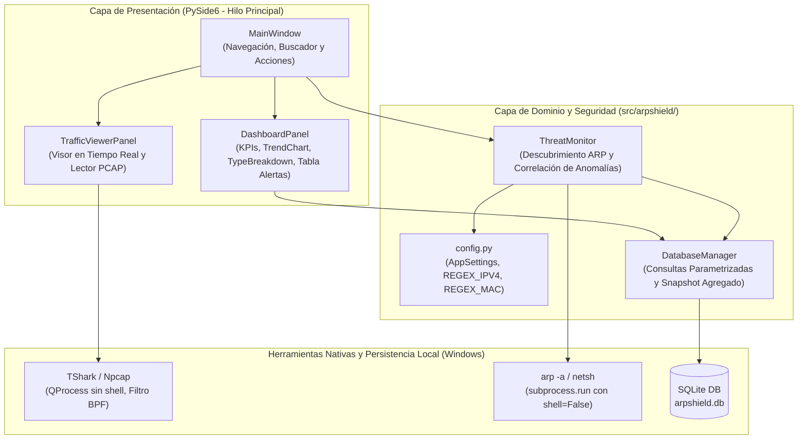
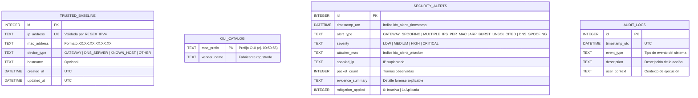
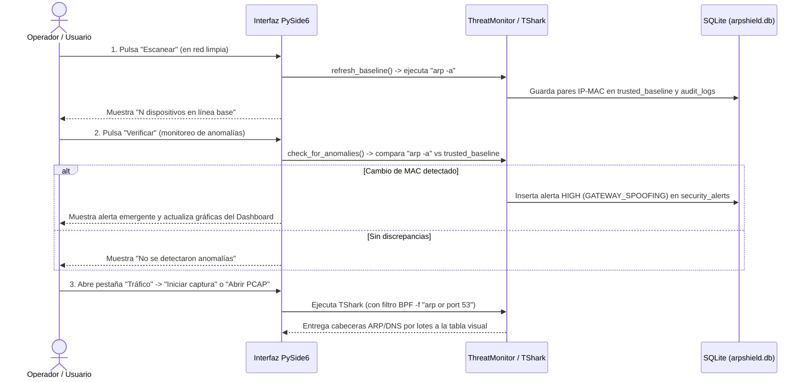

# ARPShield — Documentación Integral del Proyecto (SRS, Arquitectura, CVE, Manual de Uso y Plan QA)

**Proyecto:** ARPShield — Sistema Local de Detección y Prevención de Intrusiones (IDS/IPS) contra Suplantación ARP y Envenenamiento DNS  
**Versión del Documento:** 1.0.0  
**Fecha de Consolidación:** 10 de noviembre de 2026  
**Equipo de Desarrollo (Capa 8):**
* **Andres Ferney Garcia Ramirez** (C.C. 1005564075) — *Líder Técnico & Desarrollador Principal*
* **Juan David Rico Aldana** (C.C. 1096801885) — *Responsable de Seguridad, Calidad & Documentador*

**Marcos Normativos y Estándares Aplicados:**
* **Ingeniería de Requisitos:** IEEE Std 830 / ISO/IEC/IEEE 29148
* **Seguridad en Aplicaciones:** OWASP Application Security Verification Standard (ASVS v4.0.3)
* **Desarrollo Seguro:** NIST Secure Software Development Framework (SSDF — SP 800-218)
* **Seguridad de Redes:** ISO/IEC 27033-1 (Cláusula 9.3) e ISO/IEC 27033-3 (Cláusula 7.2)
* **Modelado de Amenazas y Vulnerabilidades:** Microsoft STRIDE, NIST NVD (CVE / CVSS v3.1 & v4.0 / CWE) y CISA KEV

---

## Tabla de Contenidos

1. [Especificación de Requisitos de Software (SRS)](#1-especificación-de-requisitos-de-software-srs)
   * [1.1 Propósito y Alcance](#11-propósito-y-alcance)
   * [1.2 Exclusiones Explícitas del Alcance](#12-exclusiones-explícitas-del-alcance)
   * [1.3 Perfiles de Usuario e Interesados](#13-perfiles-de-usuario-e-interesados)
   * [1.4 Requisitos Funcionales (RF)](#14-requisitos-funcionales-rf)
   * [1.5 Requisitos No Funcionales (RNF)](#15-requisitos-no-funcionales-rnf)
   * [1.6 Requisitos de Seguridad y Cumplimiento Normativo (RS)](#16-requisitos-de-seguridad-y-cumplimiento-normativo-rs)
2. [Arquitectura Técnica, Modelo de Datos y Seguridad STRIDE](#2-arquitectura-técnica-modelo-de-datos-y-seguridad-stride)
   * [2.1 Arquitectura de Componentes y Concurrencia](#21-arquitectura-de-componentes-y-concurrencia)
   * [2.2 Modelo Relacional de Base de Datos y Diccionario de Datos](#22-modelo-relacional-de-base-de-datos-y-diccionario-de-datos)
   * [2.3 Matriz de Amenazas STRIDE y Reglas de Validación](#23-matriz-de-amenazas-stride-y-reglas-de-validación)
3. [Análisis de Vulnerabilidades CVE (NIST NVD & CISA KEV)](#3-análisis-de-vulnerabilidades-cve-nist-nvd--cisa-kev)
   * [3.1 Alcance Metodológico de la Consulta NVD](#31-alcance-metodológico-de-la-consulta-nvd)
   * [3.2 CVEs de Protocolo y Ataques en Red Local (ARP y DNS)](#32-cves-de-protocolo-y-ataques-en-red-local-arp-y-dns)
   * [3.3 CVEs Asociados al Stack Tecnológico e Infraestructura](#33-cves-asociados-al-stack-tecnológico-e-infraestructura)
   * [3.4 Mitigación Aportada por ARPShield y Límites Operativos](#34-mitigación-aportada-por-arpshield-y-límites-operativos)
4. [Matriz de Trazabilidad Integral (RTM)](#4-matriz-de-trazabilidad-integral-rtm)
5. [Manual de Instalación, Usuario y Operación](#5-manual-de-instalación-usuario-y-operación)
   * [5.1 Requisitos del Sistema e Instalación Paso a Paso](#51-requisitos-del-sistema-e-instalación-paso-a-paso)
   * [5.2 Recorrido por la Interfaz Gráfica](#52-recorrido-por-la-interfaz-gráfica)
   * [5.3 Flujo Operativo de Detección, Análisis PCAP y Mitigación](#53-flujo-operativo-de-detección-análisis-pcap-y-mitigación)
   * [5.4 Solución de Problemas Frecuentes (Troubleshooting)](#54-solución-de-problemas-frecuentes-troubleshooting)
6. [Plan de Pruebas de QA, Seguridad y Validación en Laboratorio](#6-plan-de-pruebas-de-qa-seguridad-y-validación-en-laboratorio)
   * [6.1 Estrategia y Niveles de Prueba](#61-estrategia-y-niveles-de-prueba)
   * [6.2 Ejecución de Pruebas Unitarias Automatizadas](#62-ejecución-de-pruebas-unitarias-automatizadas)
   * [6.3 Catálogo de Casos de Prueba (Unitarias, ASVS y Laboratorio)](#63-catálogo-de-casos-de-prueba-unitarias-asvs-y-laboratorio)
   * [6.4 Protocolo de Simulación de Ataques en Laboratorio](#64-protocolo-de-simulación-de-ataques-en-laboratorio)
7. [Estado Actual de Implementación y Hoja de Ruta de Cierre](#7-estado-actual-de-implementación-y-hoja-de-ruta-de-cierre)

---

## 1. Especificación de Requisitos de Software (SRS)

### 1.1 Propósito y Alcance
**ARPShield** es un sistema local de detección y prevención de intrusiones (IDS/IPS) de escritorio diseñado para sistemas operativos **Windows 10 y Windows 11**. Su propósito es proteger estaciones de trabajo conectadas a redes de área local (LAN) compartidas —como campus universitarios, laboratorios de cómputo y pequeñas o medianas empresas (PyMEs)— frente a ataques de **suplantación ARP (*ARP Spoofing / Cache Poisoning*)** en Capa 2 y **envenenamiento/falsificación DNS (*DNS Spoofing*)** en Capa 3, los cuales habilitan intercepción de tráfico *Man-in-the-Middle* (MiTM) y denegación de servicio (DoS).

El sistema combina:
1. **Inspección de tabla ARP local y captura pasiva de paquetes** mediante `TShark`, `Npcap` y `Scapy`.
2. **Correlación contra una línea base autorizada** (`trusted_baseline`) almacenada localmente en SQLite.
3. **Observabilidad gráfica explicable** en tiempo real y análisis forense de archivos `.pcap` / `.pcapng` con `PySide6`.
4. **Capacidad de contención local reversible** fijando entradas ARP estáticas a través de la utilidad nativa `netsh` de Windows.

### 1.2 Exclusiones Explícitas del Alcance
Con el fin de delimitar con precisión las fronteras de seguridad del sistema:
* **No descifra tráfico cifrado (HTTPS / TLS / SSH)** ni actúa como proxy de inspección profunda de paquetes (DPI).
* **No almacena cargas útiles (*payloads*) de Capa 7** por cumplimiento estricto de privacidad (`OWASP ASVS V7.4.1`).
* **No sustituye controles de infraestructura de red en switches gestionados** tales como *Dynamic ARP Inspection* (DAI), *DHCP Snooping* o autenticación *IEEE 802.1X*.
* **No ejecuta acciones ofensivas en la red** (no realiza *counter-spoofing* ni inyecta paquetes de desautenticación); la mitigación se aplica exclusivamente sobre la tabla ARP del host local.

### 1.3 Perfiles de Usuario e Interesados
| Perfil | Descripción Técnica | Necesidades Principales en ARPShield |
|---|---|---|
| **Operador / Administrador de Laboratorio o PyME** | Personal técnico encargado de supervisar la seguridad de los equipos en una subred local. | Visualizar rápidamente alertas críticas, inspeccionar tramas ARP/DNS en vivo, analizar capturas `.pcap` forenses y aplicar blindaje estático al gateway. |
| **Usuario Avanzado en Red Compartida** | Estudiante, investigador o profesional conectado a una red LAN potencialmente hostil. | Verificar si la puerta de enlace (router) ha cambiado de dirección física MAC y proteger su equipo sin requerir conocimientos profundos de consola. |
| **Auditor de Seguridad / Evaluador QA** | Responsable de verificar la trazabilidad de incidentes y el cumplimiento de normas de diseño seguro. | Consultar registros de auditoría en UTC (`audit_logs`), evidencia estructurada (`security_alerts`) y comprobar los controles `OWASP ASVS` y `STRIDE`. |

### 1.4 Requisitos Funcionales (RF)

| ID | Nombre del Requisito | Descripción Detallada | Prioridad |
|---|---|---|---|
| **RF-01** | **Descubrimiento de Red y Línea Base Confiable** | El sistema debe consultar la tabla ARP del sistema operativo (`arp -a`), validar sintácticamente cada par IPv4-MAC e inicializar o actualizar la tabla `trusted_baseline` identificando roles (`GATEWAY`, `DNS_SERVER`, `KNOWN_HOST`, `OTHER`). | Alta |
| **RF-02** | **Captura Pasiva de Tráfico en Tiempo Real** | El sistema debe detectar las interfaces de red disponibles mediante `TShark -D` (`Npcap`) y capturar en tiempo real tramas ARP y DNS extrayendo exclusivamente 17 campos de cabecera de Capa 2 y Capa 3 sin bloquear la interfaz gráfica. | Alta |
| **RF-03** | **Motor de Correlación y Detección de Anomalías** | El sistema debe analizar el estado de la red y el flujo de paquetes para detectar y clasificar cuatro tipos de incidentes:<br>1. `GATEWAY_SPOOFING`: Cambio en la MAC asociada a una IP registrada en la línea base.<br>2. `MULTIPLE_IPS_PER_MAC`: Una misma MAC reclamando múltiples direcciones IPv4 distintas.<br>3. `ARP_BURST_UNSOLICITED`: Ráfagas anómalas de respuestas ARP gratuitas (`opcode 2`).<br>4. `DNS_SPOOFING`: Respuestas DNS originadas desde fuentes no autorizadas o incongruentes. | Alta |
| **RF-04** | **Análisis Forense de Archivos PCAP** | El sistema debe permitir cargar archivos de captura fuera de línea (`.pcap` y `.pcapng`), aplicar filtros de visualización y presentar las tramas decodificadas para inspección forense. | Media |
| **RF-05** | **Persistencia de Alertas y Bitácora de Auditoría** | Cada anomalía detectada y cada actualización de línea base debe registrarse de forma persistente en SQLite con marca de tiempo UTC (`timestamp_utc`), severidad (`LOW`, `MEDIUM`, `HIGH`, `CRITICAL`), MAC atacante, IP afectada, conteo de paquetes y resumen de evidencia. | Alta |
| **RF-06** | **Dashboard Analítico de Seguridad** | La interfaz debe presentar tarjetas de indicadores clave (dispositivos detectados, total de alertas, alertas de riesgo alto/crítico, entradas de confianza), un gráfico de tendencia de los últimos 12 días, un gráfico de anillo por tipo de alerta, buscador en tiempo real y tabla de alertas recientes. | Alta |
| **RF-07** | **Mitigación Local mediante Blindaje ARP Estático** | El sistema debe proporcionar un mecanismo para fijar la asociación IP-MAC legítima del Gateway como entrada estática en Windows invocando `netsh interface ipv4 add neighbors` previa validación y confirmación administrativa. | Media |
| **RF-08** | **Reversión del Blindaje a Modo Dinámico** | Al finalizar la sesión de protección o a solicitud del usuario, el sistema debe permitir restaurar la entrada ARP intervenida a su comportamiento dinámico predeterminado en el sistema operativo. | Media |

### 1.5 Requisitos No Funcionales (RNF)

| ID | Categoría | Especificación y Métrica de Aceptación |
|---|---|---|
| **RNF-01** | **Rendimiento y Fluidez de Interfaz** | La interfaz gráfica (`PySide6`) no debe congelarse durante ráfagas de captura. Las actualizaciones de la tabla de tráfico deben procesarse por lotes temporizados (`UI_FLUSH_INTERVAL_MS = 100 ms` / lotes de paquetes) con columnas de ancho interactivo fijo para mantener inserciones en $O(1)$. |
| **RNF-02** | **Consumo Acotado de Memoria (Bajos Recursos)** | El historial en memoria del visor de paquetes debe estar limitado mediante una estructura acotada (`MAX_PACKET_ROWS` de 500 a 1.000 filas) y el dashboard debe consultar agregaciones SQL limitadas a las 100 alertas más recientes (`RECENT_ALERT_LIMIT = 100`), permitiendo operar en equipos desde 4 GB hasta 8 GB de RAM. |
| **RNF-03** | **Filtrado en Kernel (BPF)** | En capturas en vivo con filtros comunes (`arp or dns`, `arp`, `dns`), el sistema debe inyectar automáticamente el filtro BPF equivalente (`-f "arp or port 53"`) en `TShark`/`Npcap` para descartar tráfico pesado (video, descargas HTTPS) antes de llegar a Python. |
| **RNF-04** | **Compatibilidad de Plataforma** | Ejecución nativa en Windows 10 / 11 (x64) con Python `>= 3.10`, `PySide6 >= 6.6.0`, `Scapy >= 2.8.0` y compatibilidad con instalaciones estándar de Wireshark/TShark. |
| **RNF-05** | **Mantenibilidad y Pruebas** | El código debe separar claramente configuración (`config.py`), persistencia (`database.py`), lógica de detección (`monitor.py`) y presentación (`ui/`), contando con pruebas unitarias automatizadas ejecutables con `unittest` o `pytest`. |

### 1.6 Requisitos de Seguridad y Cumplimiento Normativo (RS)

| ID | Norma / Cláusula | Requisito de Seguridad Obligatorio | Implementación Técnica en ARPShield |
|---|---|---|---|
| **RS-01** | **OWASP ASVS V5.1.1 & V5.2.2** | Prevención de inyección de comandos del SO (*OS Command Injection*). | Prohibición absoluta de `shell=True`. Toda invocación a `arp`, `tshark` y `netsh` utiliza listas de argumentos estructuradas en `subprocess.run` o `QProcess`, precedida por validación estricta con expresiones regulares (`REGEX_IPV4`, `REGEX_MAC`). |
| **RS-02** | **OWASP ASVS V5.1.4** | Prevención de Denegación de Servicio local (DoS) por agotamiento de memoria/CPU. | Uso de buffer circular en memoria (`collections.deque`), renderizado por lotes, truncado de campos a `FIELD_COUNT = 17` y filtro de captura BPF. |
| **RS-03** | **OWASP ASVS V7.1.1 & V7.4.1** | Manejo controlado de errores y privacidad de datos en captura. | Captura de excepciones `OSError` / `TimeoutExpired` mediante cuadros de diálogo `QMessageBox` y etiquetas de estado amigables sin exponer *stack traces*. Extracción exclusiva de cabeceras L2/L3 descartando payloads de usuario. |
| **RS-04** | **OWASP ASVS V8.3.1** | Integridad y protección de la base de datos local en reposo. | Almacenamiento en ruta de perfil local del usuario (`%LOCALAPPDATA%\ARPShield\arpshield.db`), diseño compatible con `SQLCipher` y control de integridad mediante suma de verificación `SHA-256`. |
| **RS-05** | **NIST SSDF PW.1.1** | Principio de Mínimo Privilegio. | La aplicación se ejecuta con privilegios de usuario estándar para monitoreo, visualización y análisis PCAP; únicamente requiere privilegios de Administrador (UAC) para modificar la tabla ARP con `netsh`. |
| **RS-06** | **ISO/IEC 27033-1 Cl. 9.3 & 27033-3 Cl. 7.2** | Auditoría forense y controles contra suplantación en capa de enlace. | Registro cronológico en UTC de alertas y eventos en `security_alerts` y `audit_logs`, junto con verificación continua de asociaciones IP-MAC frente a la línea base. |

---

## 2. Arquitectura Técnica, Modelo de Datos y Seguridad STRIDE

### 2.1 Arquitectura de Componentes y Concurrencia

ARPShield implementa una arquitectura modular desacoplada donde la interfaz gráfica en `PySide6` actúa como capa de observabilidad y control, apoyándose en subprocesos seguros del sistema (`TShark`, `arp`, `netsh`), el motor de monitoreo (`ThreatMonitor`) y el gestor de persistencia (`DatabaseManager`).



### 2.2 Modelo Relacional de Base de Datos y Diccionario de Datos

El módulo [`src/arpshield/database.py`](../src/arpshield/database.py) gestiona cuatro tablas relacionales con integridad de dominio mediante cláusulas `CHECK` e índices de búsqueda:



### 2.3 Matriz de Amenazas STRIDE y Reglas de Validación

| # | Categoría STRIDE | Activo Afectado | Escenario de Amenaza | Control Mitigador en ARPShield |
|---|---|---|---|---|
| **1** | **Denial of Service (DoS)** | Motor de captura y tabla visual de paquetes (`TrafficViewerPanel`). | Inundación de tramas ARP/DNS para agotar la RAM o congelar el bucle de eventos de `PySide6`. | Buffer circular en memoria, refresco por lotes con `QTimer`, desactivación temporal de repintado (`setUpdatesEnabled(False)`), columnas `Interactive` y filtro BPF `-f` en kernel (`OWASP ASVS V5.1.4`). |
| **2** | **Elevation of Privilege (EoP)** | Invocación de herramientas del sistema (`tshark`, `arp`, `netsh`). | Inyección de comandos en consola aprovechando caracteres especiales en filtros, nombres de interfaz o direcciones IP/MAC. | Ejecución exclusiva con `shell=False` / `QProcess` pasando listas de argumentos separados y validación previa con `REGEX_IPV4` y `REGEX_MAC` (`OWASP ASVS V5.1.1 & V5.2.2`). |
| **3** | **Tampering (Alteración)** | Base de datos local `arpshield.db` (`trusted_baseline` y `security_alerts`). | Modificación maliciosa de la línea base para registrar la MAC de un atacante como si fuera el Gateway legítimo. | Ubicación en directorio local de usuario protegido por ACL NTFS, consultas SQL 100 % parametrizadas (`?`) y diseño de verificación de integridad `SHA-256` (`OWASP ASVS V8.3.1`). |
| **4** | **Information Disclosure** | Logs, base de datos y mensajes de excepción en la interfaz. | Exposición de datos sensibles del tráfico del usuario (payloads HTTP/credenciales) o de rutas y *stack traces* internos en errores. | Extracción estricta de 17 campos de cabecera L2/L3 en `TShark` (`-e frame.time`, `-e arp.*`, `-e dns.*`) sin payloads y captura controlada de errores con `QMessageBox` (`OWASP ASVS V7.1.1 & V7.4.1`). |

**Expresiones Regulares de Seguridad ([`src/arpshield/config.py`](../src/arpshield/config.py)):**
* **IPv4 (`REGEX_IPV4`):** `^((25[0-5]|2[0-4][0-9]|[01]?[0-9][0-9]?)\.){3}(25[0-5]|2[0-4][0-9]|[01]?[0-9][0-9]?)$`
* **MAC (`REGEX_MAC`):** `^([0-9A-Fa-f]{2}[:-]){5}([0-9A-Fa-f]{2})$`

---

## 3. Análisis de Vulnerabilidades CVE (NIST NVD & CISA KEV)

### 3.1 Alcance Metodológico de la Consulta NVD
El análisis de vulnerabilidades de **ARPShield** se fundamenta en registros oficiales verificados en la **National Vulnerability Database (NVD)** del NIST y contrastados contra el catálogo **CISA Known Exploited Vulnerabilities (KEV)**. Los registros se dividen en dos grupos:
1. **Amenazas de red y protocolo (Sección 3.2):** Demuestran con evidencia histórica y reciente por qué el protocolo ARP y la resolución DNS en redes locales requieren monitoreo activo.
2. **Superficie de ataque del stack tecnológico (Sección 3.3):** Sustentan los controles defensivos aplicados sobre `Scapy`, `TShark` y `Npcap` dentro de la arquitectura de ARPShield.

> [!IMPORTANT]
> Los CVE listados a continuación **no representan fallas en el código propio de ARPShield**, sino las debilidades de protocolo que la herramienta detecta y los riesgos en componentes de terceros que el diseño de seguridad de ARPShield mitiga.

### 3.2 CVEs de Protocolo y Ataques en Red Local (ARP y DNS)

| Identificador CVE | Estado CISA KEV | Publicación NVD | Fuente / CNA | Severidad CVSS y CWE | Descripción en NVD y Relevancia Directa para ARPShield |
|---|---|---|---|---|---|
| **[CVE-1999-0667](https://nvd.nist.gov/vuln/detail/CVE-1999-0667)** | No listado | `1997-09-18` | `cve@mitre.org` | **CVSS v2.0:** `10.0 HIGH`<br>`NVD-CWE-Other` | El protocolo ARP carece de autenticación, permitiendo a cualquier host falsificar respuestas ARP y envenenar la caché ARP para interceptar tráfico o causar DoS. Es la vulnerabilidad estructural que da origen al motor de detección IP-MAC y al blindaje con `netsh` de ARPShield (`ISO/IEC 27033-3 Cl. 7.2`). |
| **[CVE-2018-17195](https://nvd.nist.gov/vuln/detail/CVE-2018-17195)** | No listado | `2018-12-19` | `security@apache.org` | **CVSS v3.0:** `7.5 HIGH`<br>`CWE-319` / `CWE-863` | En Apache NiFi `1.0.0`–`1.7.1`, un ataque de *ARP spoofing* combinado con *Man-in-the-Middle* en la misma subred permitía explotar peticiones entre dominios (CSRF). Evidencia cómo el envenenamiento ARP en Capa 2 sirve de vector inicial para comprometer aplicaciones. |
| **[CVE-2019-11189](https://nvd.nist.gov/vuln/detail/CVE-2019-11189)** | No listado | `2020-02-20` | `cve@mitre.org` | **CVSS v3.1:** `7.5 HIGH`<br>`CWE-290` | En ONOS `<= 2.0.0`, el envío de respuestas ARP gratuitas (*Gratuitous ARP*) manipuladas provocaba la eliminación de reglas de control de acceso. Sustenta la clasificación de alerta `ARP_BURST_UNSOLICITED` y la inspección de `arp.opcode == 2` en ARPShield. |
| **[CVE-2021-32575](https://nvd.nist.gov/vuln/detail/CVE-2021-32575)** | No listado | `2021-06-17` | `cve@mitre.org` | **CVSS v3.1:** `6.5 MEDIUM`<br>`CWE-1100` | HashiCorp Nomad hasta `1.0.4` permitía *ARP spoofing* entre tareas ejecutadas en el mismo nodo bajo red `bridge`. Demuestra la vigencia del riesgo en entornos virtualizados y delimita el alcance local del endpoint. |
| **[CVE-2025-52890](https://nvd.nist.gov/vuln/detail/CVE-2025-52890)** | No listado | `2025-06-25` | `github.com` | **CVSS v3.1:** `8.1 HIGH`<br>`CWE-863` | En Incus `6.12` y `6.13`, reglas defectuosas de `nftables` en redes `bridge` eludían parcialmente el filtrado MAC/IPv4, permitiendo suplantación ARP entre instancias. Confirma el valor de contar con detección en el propio endpoint o análisis forense `.pcap`. |
| **[CVE-2008-1447](https://nvd.nist.gov/vuln/detail/CVE-2008-1447)** | No listado | `2008-07-08` | `cve@mitre.org` | **CVSS v3.1:** `6.8 MEDIUM`<br>`CWE-330` | Debilidad clásica en implementaciones DNS que permitía falsificar respuestas DNS (*cache poisoning*) por baja entropía en IDs de transacción y puertos UDP. Respalda el segundo vector de ARPShield: inspección de tráfico DNS y alertas `DNS_SPOOFING`. |

### 3.3 CVEs Asociados al Stack Tecnológico e Infraestructura

| Identificador CVE | Publicación NVD | Componente Relacionado | Severidad CVSS y CWE | Amenaza STRIDE | Descripción y Control Defensivo Aplicado en ARPShield |
|---|---|---|---|---|---|
| **[CVE-2019-1010142](https://nvd.nist.gov/vuln/detail/CVE-2019-1010142)** | `2019-07-19` | `Scapy` | **CVSS v3.1:** `7.5 HIGH`<br>`CWE-835` (Loop infinito) | **STRIDE #1: DoS** | En Scapy `2.4.0`, un paquete manipulado causaba un bucle infinito y agotamiento de recursos. ARPShield exige `scapy >= 2.8.0`, delega el parseo de campos en vivo a `TShark` con filtro BPF y acota el buffer circular de paquetes (`OWASP ASVS V5.1.4`). |
| **[CVE-2026-3959](https://nvd.nist.gov/vuln/detail/CVE-2026-3959)** | `2026-03-11` | `TShark` (Manejadores CLI) | **CVSS v3.1:** `5.3 MEDIUM`<br>`CWE-78` (OS Command Injection) | **STRIDE #2: EoP** | Inyección de comandos del SO en un conector CLI de `TShark` por concatenación insegura de argumentos. ARPShield mitiga este vector ejecutando `tshark`, `arp` y `netsh` estrictamente con arreglos de argumentos sin shell (`shell=False` / `QProcess`) y validación Regex (`ASVS V5.1.1 & V5.2.2`). |
| **[CVE-2026-33921](https://nvd.nist.gov/vuln/detail/CVE-2026-33921)** | `2026-08-11` | `Npcap` (Windows) | **CVSS v3.1:** `5.2 MEDIUM`<br>**v4.0:** `4.8 MEDIUM` · `CWE-1188` | **STRIDE #4: Info Disclosure** | Configuraciones por defecto inseguras en el instalador de Npcap exponían captura/inyección a usuarios no autorizados. ARPShield opera bajo mínimo privilegio (`NIST SSDF PW.1.1`) y filtra únicamente cabeceras L2/L3 descartando cualquier payload (`ASVS V7.4.1`). |

### 3.4 Mitigación Aportada por ARPShield y Límites Operativos
* **Frente a `CVE-1999-0667` y `CVE-2019-11189`:** ARPShield aporta visibilidad inmediata sobre cambios en la relación IP-MAC y ráfagas ARP, permitiendo blindar la entrada del Gateway con `netsh`.
* **Frente a `CVE-2018-17195`:** Actúa como alerta temprana en Capa 2 antes de que el atacante consolide el posicionamiento MiTM, aunque no sustituye el uso de HTTPS/TLS ni cabeceras anti-CSRF en las aplicaciones web.
* **Frente a `CVE-2021-32575` y `CVE-2025-52890`:** Cubre el tráfico que alcanza la interfaz del host monitoreado o las capturas `.pcap` extraídas del segmento, complementando el aislamiento del hipervisor o switch.

---

## 4. Matriz de Trazabilidad Integral (RTM)

La siguiente matriz vincula cada requisito del **SRS** con los 6 componentes arquitectónicos, los registros **CVE / STRIDE**, los controles normativos, los archivos de código fuente y los casos de prueba del **Plan QA**:

| Requisito SRS | Componente Oficial | CVE / STRIDE Asociado | Control Normativo | Módulo en Código (`src/arpshield/`) | Caso de Prueba QA | Estado Actual |
|---|---|---|---|---|---|---|
| **RF-01** (Descubrimiento y Línea Base) | 01 Captura / 03 Base de Datos | `CVE-1999-0667` | `OWASP ASVS V5.1` · `ISO 27033-3 Cl. 7.2` | [`monitor.py`](../src/arpshield/monitor.py) (`discover_local_network`, `refresh_baseline`) · [`config.py`](../src/arpshield/config.py) | `TC-02`, `TC-03`, `TC-06` | **Implementado** |
| **RF-02** (Captura en Tiempo Real) | 01 Captura de Tráfico | `CVE-2019-1010142`, `CVE-2026-33921` · STRIDE #1 & #4 | `OWASP ASVS V5.1.4` · `ASVS V7.4.1` · `NIST PW.1.1` | [`ui/traffic_viewer.py`](../src/arpshield/ui/traffic_viewer.py) (`start_capture`, `_packet_arguments`) | `TC-04`, `TC-05`, `TC-08` | **Implementado (vía TShark)** |
| **RF-03** (Motor de Correlación) | 02 Analizador de Amenazas | `CVE-1999-0667`, `CVE-2019-11189`, `CVE-2008-1447` | `ISO/IEC 27033-3 Cl. 7.2` | [`monitor.py`](../src/arpshield/monitor.py) (`check_for_anomalies`) | `TC-02`, `TC-10` | **Parcial** (`GATEWAY_SPOOFING` activo; faltan 3 reglas en vivo) |
| **RF-04** (Análisis Forense PCAP) | 05 Análisis de Archivos PCAP | `CVE-2026-3959`, `CVE-2021-32575`, `CVE-2025-52890` | `OWASP ASVS V5.1.1` · `ASVS V5.1` | [`ui/traffic_viewer.py`](../src/arpshield/ui/traffic_viewer.py) (`load_capture_file`) | `TC-05`, `TC-11` | **Parcial** (Visualización lista; falta correlación automática) |
| **RF-05** (Persistencia SQLite y Auditoría) | 03 Base de Datos y Línea Base | `CVE-1999-0667` · STRIDE #3 (Tampering) | `ISO/IEC 27033-1 Cl. 9.3` · `OWASP ASVS V8.3.1` | [`database.py`](../src/arpshield/database.py) (`DatabaseManager`) | `TC-01`, `TC-02`, `TC-03` | **Implementado** (Pendiente hash SHA-256 al inicio) |
| **RF-06** (Dashboard y Métricas) | 04 Panel de Monitoreo (GUI) | Observabilidad transversal | `OWASP ASVS V7.1.1` | [`ui/dashboard.py`](../src/arpshield/ui/dashboard.py) · [`ui/main_window.py`](../src/arpshield/ui/main_window.py) | `TC-03`, `TC-09` | **Implementado** (Requiere limpiar conflicto de merge) |
| **RF-07 / RF-08** (Mitigación `netsh` y Reversión) | 06 Protección de Tabla ARP | `CVE-1999-0667`, `CVE-2026-3959` · STRIDE #2 (EoP) | `OWASP ASVS V5.1.1 & V5.2.2` · `NIST SSDF PW.1.1` | [`ui/main_window.py`](../src/arpshield/ui/main_window.py) (`apply_mitigation`) · [`developer_setup_guidelines.md`](./developer_setup_guidelines.md) | `TC-07`, `TC-12` | **Diseñado / En integración** |

---

## 5. Manual de Instalación, Usuario y Operación

### 5.1 Requisitos del Sistema e Instalación Paso a Paso

#### A. Requisitos de Hardware y Sistema Operativo
* **Sistema Operativo:** Windows 10 o Windows 11 (64 bits).
* **Memoria RAM:** Mínimo 4 GB de RAM (8 GB recomendados para capturas prolongadas).
* **Herramientas Externas Requeridas:**
  1. **Wireshark / TShark:** Necesario para la captura de paquetes en vivo y la lectura de archivos `.pcap`. Durante la instalación de Wireshark, asegúrate de marcar la opción de instalar **TShark**. ARPShield lo detectará automáticamente si está en la variable de entorno `PATH` o en `C:\Program Files\Wireshark\tshark.exe`.
  2. **Controlador Npcap:** Se instala junto con Wireshark. Permite capturar tramas de Capa 2 en las tarjetas de red de Windows.

#### B. Instalación de ARPShield
Abre una terminal de PowerShell en la carpeta raíz del proyecto y ejecuta:

```powershell
# 1. (Opcional pero recomendado) Crear y activar un entorno virtual
python -m venv .venv
.\.venv\Scripts\Activate.ps1

# 2. Instalar las dependencias del proyecto (PySide6 y Scapy)
python -m pip install -r requirements.txt

# 3. Iniciar la aplicación
python main.py
```

---

### 5.2 Recorrido por la Interfaz Gráfica

Al ejecutar `python main.py`, se abrirá la ventana principal de **ARPShield**, estructurada en tres áreas:

1. **Barra Lateral Izquierda (Navegación):**
   * **◈ Dashboard:** Vista principal con métricas de seguridad, gráficas y tabla de alertas recientes.
   * **◎ Tráfico:** Analizador de paquetes ARP/DNS en tiempo real y lector de archivos `.pcap` / `.pcapng`.
   * **⚙ Ajustes:** Información sobre el estado de detección de `TShark` y la ruta exacta de la base de datos SQLite local (`arpshield.db`).
2. **Barra Superior de Control:**
   * **Buscador (`Buscar en alertas...`):** Filtra instantáneamente las filas de la tabla de alertas por IP, MAC, severidad, tipo o texto de evidencia.
   * **Indicador de Estado (`● Monitoreo local`):** Muestra el resultado de la última operación ejecutada.
   * **Botón `Escanear`:** Consulta la tabla ARP actual de Windows y registra los dispositivos descubiertos como línea base en `trusted_baseline`.
   * **Botón `Verificar`:** Contrasta la tabla ARP actual contra la línea base guardada y genera alertas si detecta algún cambio de dirección MAC.

---

### 5.3 Flujo Operativo de Detección, Análisis PCAP y Mitigación



#### Paso 1: Establecer la Línea Base de Confianza
1. Conéctate a la red local cuando tengas certeza de que se encuentra operativa y libre de incidentes.
2. Haz clic en el botón azul **`Escanear`** de la esquina superior derecha.
3. Las tarjetas **DISPOSITIVOS DETECTADOS** y **ENTRADAS DE CONFIANZA** se actualizarán mostrando el número de hosts registrados.

#### Paso 2: Verificar Anomalías de Suplantación ARP
1. Haz clic en el botón **`Verificar`**.
2. Si algún dispositivo en la red cambió su dirección física MAC respecto a la registrada en la línea base, ARPShield emitirá una notificación informando el número de anomalías detectadas y añadirá el incidente en la tabla **Alertas recientes** del Dashboard con código de color según su severidad:
   * **Verde (`LOW`):** Evento informativo de bajo impacto.
   * **Naranja (`MEDIUM`):** Anomalía moderada que requiere observación.
   * **Rojo (`HIGH` / `CRITICAL`):** Posible suplantación ARP del Gateway o envenenamiento DNS activo.

#### Paso 3: Captura de Tráfico en Tiempo Real (Pestaña `Tráfico`)
1. Dirígete a **◎ Tráfico** en el menú lateral.
2. Selecciona tu adaptador de red activo (por ejemplo, *Wi-Fi* o *Ethernet*) en el desplegable **Interfaz**. Si no aparece, pulsa **`Detectar interfaces`**.
3. En el campo **Filtro**, mantén el valor por defecto `arp or dns` (o escribe `arp` o `dns`). ARPShield traducirá automáticamente estos filtros a un filtro BPF de kernel (`arp or port 53`) para minimizar el uso de CPU y memoria.
4. Haz clic en **`Iniciar captura`**. Verás aparecer en tiempo real las solicitudes/respuestas ARP (en color naranja) y las consultas/respuestas DNS (en color púrpura).
5. Pulsa **`Detener`** cuando desees finalizar la captura.

#### Paso 4: Análisis Forense de Archivos `.pcap` / `.pcapng`
1. En la pestaña **◎ Tráfico**, asegúrate de que no haya una captura en vivo activa.
2. Haz clic en **`Abrir PCAP`** y selecciona un archivo `.pcap` o `.pcapng` desde tu equipo.
3. ARPShield procesará el archivo aplicando el filtro configurado en el cuadro **Filtro** y mostrará todas las tramas coincidentes para su inspección detallada.

#### Paso 5: Mitigación Local con `netsh` (En caso de ataque confirmado)
Para fijar manualmente o verificar la dirección MAC legítima de tu puerta de enlace en una consola de PowerShell con privilegios de **Administrador**:

```powershell
# Consultar la tabla de vecinos ARP actual en Windows
netsh interface ipv4 show neighbors

# Fijar estáticamente la IP y MAC legítimas del Gateway (Mitigación IPS)
netsh interface ipv4 add neighbors "Wi-Fi" 192.168.1.1 AA-BB-CC-DD-EE-FF

# Revertir a modo dinámico al finalizar la sesión
netsh interface ipv4 delete neighbors "Wi-Fi" 192.168.1.1
```

---

### 5.4 Solución de Problemas Frecuentes (*Troubleshooting*)

| Síntoma / Mensaje en Pantalla | Causa Probable | Solución Paso a Paso |
|---|---|---|
| **Ventana emergente: *"TShark no detectado"*** | Wireshark/TShark no está instalado o se modificó la variable `PATH` con el editor abierto. | 1. Instala Wireshark asegurando marcar *TShark*.<br>2. Verifica que exista `C:\Program Files\Wireshark\tshark.exe`.<br>3. Cierra y vuelve a abrir VS Code / PowerShell para recargar el `PATH`. |
| **Mensaje: *"TShark está instalado, pero no hay interfaces de captura disponibles"*** | El driver `Npcap` no está en ejecución o se instaló restringido solo a Administradores. | 1. Ejecuta `sc query npcap` en PowerShell para verificar que el servicio esté activo.<br>2. Reinstala Npcap desmarcando *"Restrict Npcap driver's access to Administrators only"* o abre ARPShield con permisos adecuados. |
| **Consumo elevado de memoria en equipos de 4 GB de RAM** | Filtro de visualización vacío o demasiado amplio en una red con mucho tráfico multimedia. | 1. Mantén siempre el filtro en `arp or dns`, `arp` o `dns` para aprovechar el filtro BPF de kernel.<br>2. Cierra navegadores con múltiples pestañas pesadas durante el análisis. |
| **Error al ejecutar `python main.py`: `ModuleNotFoundError: No module named 'PySide6'`** | Las dependencias no se instalaron en el intérprete de Python activo. | Ejecuta `python -m pip install -r requirements.txt` verificando que usas el mismo comando `python` con el que lanzas `main.py`. |

---

## 6. Plan de Pruebas de QA, Seguridad y Validación en Laboratorio

### 6.1 Estrategia y Niveles de Prueba
La validación de calidad (QA) y seguridad de ARPShield se estructura en tres niveles complementarios:
1. **Nivel 1 — Pruebas Unitarias y de Integración (`unittest`):** Verifican el esquema relacional SQLite, las operaciones CRUD, el cálculo agregado del `dashboard_snapshot`, el parseo de salidas `arp -a` en codificación Windows (`cp850`) y el formateo tabular de tramas de `TShark`.
2. **Nivel 2 — Pruebas de Controles Normativos (`OWASP ASVS` & `STRIDE`):** Verifican las cotas de memoria contra DoS (`ASVS V5.1.4`), la neutralización de inyección de comandos (`ASVS V5.1.1 & V5.2.2`) y la validación estricta de entradas (`ASVS V5.1`).
3. **Nivel 3 — Pruebas de Sistema en Laboratorio Aislado:** Validan la detección extremo a extremo frente a suplantación ARP simulada y capturas `.pcap` forenses.

### 6.2 Ejecución de Pruebas Unitarias Automatizadas
Para ejecutar la suite completa de pruebas automatizadas desde la raíz del repositorio:

```powershell
python -m unittest discover -s tests -p "test_*.py" -v
```

### 6.3 Catálogo de Casos de Prueba (Unitarias, ASVS y Laboratorio)

| ID Caso | Nivel | Nombre / Método de Prueba | Requisito / Norma | Entrada de Prueba | Resultado Esperado |
|---|---|---|---|---|---|
| **TC-01** | Unitaria | `test_initialize_creates_tables` ([`test_database.py`](../tests/test_database.py)) | `RF-05` · `ISO 27033-1 Cl. 9.3` | Inicialización de `DatabaseManager` en directorio temporal. | Creación verificada de las tablas `trusted_baseline`, `oui_catalog`, `security_alerts` y `audit_logs`. |
| **TC-02** | Unitaria | `test_round_trip_baseline_and_alert` ([`test_database.py`](../tests/test_database.py)) | `RF-01`, `RF-05` | Inserción de Gateway `192.168.1.1` (`00:11:22:33:44:55`) y alerta `GATEWAY_SPOOFING` (`AA:BB:CC:DD:EE:FF`). | Recuperación íntegra de la línea base y de la alerta con todos sus metadatos forenses. |
| **TC-03** | Unitaria | `test_dashboard_snapshot_aggregates_and_limits_recent_alerts` ([`test_database.py`](../tests/test_database.py)) | `RF-06`, `RNF-02` | 1 entrada de línea base y 3 alertas (1 `HIGH`, 1 `CRITICAL`, 1 `LOW`) con `recent_limit=2`. | `alert_count == 3`, `high_severity_count == 2`, `DNS_SPOOFING == 2` y lista `recent_alerts` acotada exactamente a 2 registros; rechazo con `ValueError` si `recent_limit <= 0`. |
| **TC-04** | Unitaria | `test_discover_local_network_handles_windows_arp_output` ([`test_database.py`](../tests/test_database.py)) | `RF-01`, `RS-01` | Salida simulada de `arp -a` codificada en `cp850` con formato Windows (`00-11-22-33-44-55`). | Parseo exitoso de la IP `192.168.1.1` y normalización de la MAC al formato `00:11:22:33:44:55`. |
| **TC-05** | Unitaria | `test_parse_tshark_interface_list` & `test_packet_fields_are_formatted_as_analyzable_columns` ([`test_traffic_viewer.py`](../tests/test_traffic_viewer.py)) | `RF-02`, `RF-04`, `RS-03` | Salida de `tshark -D` con advertencias y línea tabulada de 17 campos para solicitud ARP (`opcode 1`). | Extracción limpia de interfaces NPF y generación de fila de 8 columnas con protocolo `ARP` y detalle `"Solicitud ARP | 192.168.1.10 → 192.168.1.1"`. |
| **TC-06** | Seguridad ASVS | Validación de expresiones regulares IPv4 y MAC ([`config.py`](../src/arpshield/config.py)) | `RS-01` (`ASVS V5.1`) | Entradas malformadas o maliciosas: `"999.1.1.1"`, `"192.168.1.1; calc.exe"`, `"GG:HH:II:JJ:KK:LL"`. | `is_valid_ipv4()` e `is_valid_mac()` retornan `False` y descartan la entrada antes de cualquier persistencia o llamada a subproceso. |
| **TC-07** | Seguridad ASVS | Verificación estática de no uso de `shell=True` | `RS-01` (`ASVS V5.1.1 & V5.2.2`) · `CVE-2026-3959` | Inspección de código en `monitor.py` y `traffic_viewer.py`. | Todas las llamadas a `subprocess.run` especifican explícitamente `shell=False` y `QProcess.start` recibe el ejecutable y la lista de argumentos por separado. |
| **TC-08** | Rendimiento / DoS | Límite de historial de paquetes en memoria ([`test_traffic_viewer.py`](../tests/test_traffic_viewer.py)) | `RS-02` (`ASVS V5.1.4`) · `CVE-2019-1010142` | Ingesta continua de más de `MAX_PACKET_ROWS` paquetes ARP/DNS. | El buffer y la tabla `QTableWidget` descartan las filas más antiguas sin superar el límite máximo configurado ni bloquear el hilo de interfaz. |
| **TC-09** | Resiliencia UI | Arranque sin `TShark` instalado ([`main.py`](../main.py)) | `RS-03` (`ASVS V7.1.1`) | Ejecución de `main.py` cuando `find_tshark()` retorna `None`. | Se presenta un `QMessageBox.warning` informativo sin *stack trace* y el Dashboard + escaneo ARP siguen funcionando con normalidad. |
| **TC-10** | Laboratorio | Detección de suplantación ARP contra línea base | `RF-01`, `RF-03`, `RF-05` · `CVE-1999-0667` | Cambio de la MAC asociada al Gateway en la caché ARP local tras haber ejecutado **Escanear**. | Al pulsar **Verificar**, se registra una alerta `GATEWAY_SPOOFING` con severidad `HIGH` en SQLite y se actualiza el Dashboard. |
| **TC-11** | Laboratorio | Inspección forense de captura `.pcap` | `RF-04` | Carga de un archivo `.pcap` con tráfico mixto (ARP, DNS, HTTP) usando el botón **Abrir PCAP**. | El visor filtra y muestra las tramas ARP y DNS con sus IPs, MACs y operaciones decodificadas. |
| **TC-12** | Laboratorio | Blindaje estático con `netsh` y reversión | `RF-07`, `RF-08` · `NIST PW.1.1` | Aplicación de entrada estática para el Gateway en consola elevada y envío posterior de paquetes ARP falsos. | Windows ignora las respuestas ARP fraudulentas mientras la entrada figura como `estático` (`static`) y vuelve a `dinámico` tras la reversión. |

### 6.4 Protocolo de Simulación de Ataques en Laboratorio
Para ejecutar las pruebas de sistema (`TC-10` a `TC-12`) de manera ética y segura:
1. **Aislamiento de Red:** Configurar un entorno virtualizado (VirtualBox o VMware) en modo **Red Interna (*Internal Network*)** o **Host-Only** con dos máquinas virtuales:
   * **VM Víctima (Windows 10/11):** Ejecutando **ARPShield** con `Wireshark/TShark` y `Npcap`.
   * **VM Auditora/Atacante (Kali Linux / Ubuntu):** Con herramientas de prueba de laboratorio (`arpspoof` de la suite `dsniff` o `ettercap`).
2. **Paso A — Línea Base:** Con la VM atacante inactiva, pulsar **`Escanear`** en ARPShield dentro de la VM Windows para registrar la MAC legítima de la puerta de enlace.
3. **Paso B — Ejecución del Estímulo ARP:** Desde la VM auditora, emitir respuestas ARP asociando la IP de la puerta de enlace con la MAC de la VM auditora (`arpspoof -i eth0 -t <IP_VICTIMA> <IP_GATEWAY>`).
4. **Paso C — Verificación y Evidencia:** En ARPShield, observar las tramas `Respuesta ARP` en la pestaña **Tráfico** y pulsar **`Verificar`** en la barra superior. Comprobar que el incidente queda registrado en la tabla **Alertas recientes** y en el gráfico de anillo bajo **Suplantación gateway**.

---

## 7. Estado Actual de Implementación y Hoja de Ruta de Cierre

Con el propósito de mantener transparencia técnica entre la documentación y el código fuente actual del repositorio, a continuación se detallan las tareas pendientes para completar el 100 % del ciclo de desarrollo:

| Prioridad | Tarea Técnica Pendiente | Archivos Involucrados |
|---|---|---|
| **P0 — Inmediata** | **Resolver conflictos de fusión Git (`<<<<<<< HEAD`)** en los módulos de interfaz gráfica y unificar la constante `MAX_PACKET_ROWS` (`1000` vs `500`) en las pruebas unitarias. | [`src/arpshield/ui/main_window.py`](../src/arpshield/ui/main_window.py)<br>[`src/arpshield/ui/dashboard.py`](../src/arpshield/ui/dashboard.py)<br>[`src/arpshield/ui/traffic_viewer.py`](../src/arpshield/ui/traffic_viewer.py)<br>[`tests/test_traffic_viewer.py`](../tests/test_traffic_viewer.py) |
| **P1 — Alta** | **Enlazar `TrafficViewerPanel` con `ThreatMonitor`** para que los paquetes capturados en vivo y desde archivos `.pcap` alimenten automáticamente las reglas `MULTIPLE_IPS_PER_MAC`, `ARP_BURST_UNSOLICITED` y `DNS_SPOOFING`. | [`src/arpshield/ui/traffic_viewer.py`](../src/arpshield/ui/traffic_viewer.py)<br>[`src/arpshield/monitor.py`](../src/arpshield/monitor.py) |
| **P2 — Media** | **Conectar la mitigación `netsh` en la UI:** Integrar `set_static_arp_entry()` dentro de `MainWindow.apply_mitigation()`, añadir el botón correspondiente en la interfaz y programar la reversión a modo dinámico al cerrar la sesión. | [`src/arpshield/ui/main_window.py`](../src/arpshield/ui/main_window.py)<br>[`src/arpshield/monitor.py`](../src/arpshield/monitor.py) |
| **P3 — Media** | **Verificación de integridad `SHA-256` (`OWASP ASVS V8.3.1`) y catálogo OUI:** Validar el hash del archivo `arpshield.db` al iniciar la aplicación y poblar/consultar la tabla `oui_catalog` para mostrar el fabricante del adaptador de red. | [`src/arpshield/database.py`](../src/arpshield/database.py)<br>[`main.py`](../main.py) |

